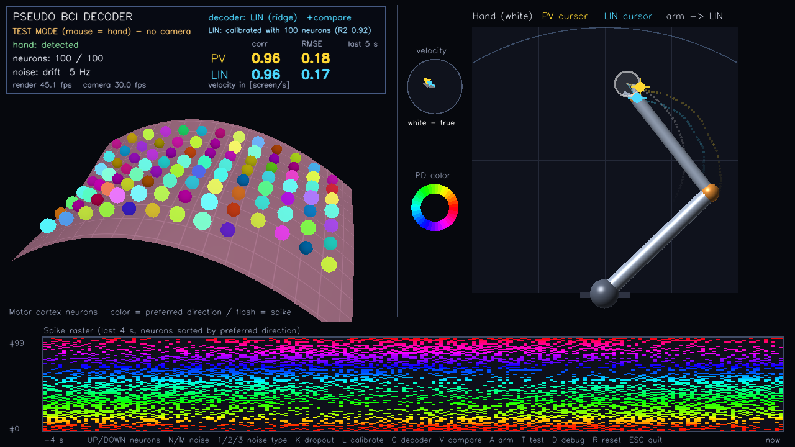
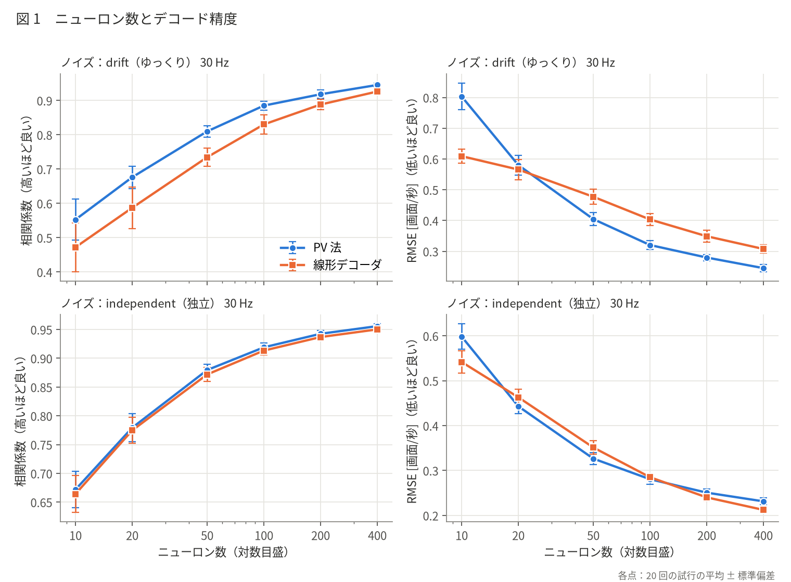
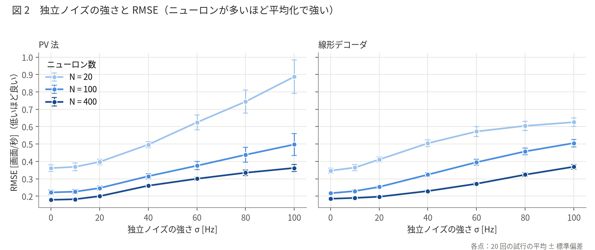
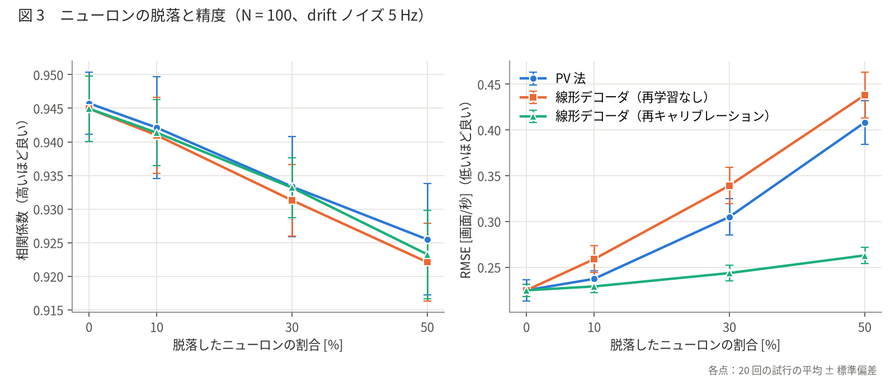
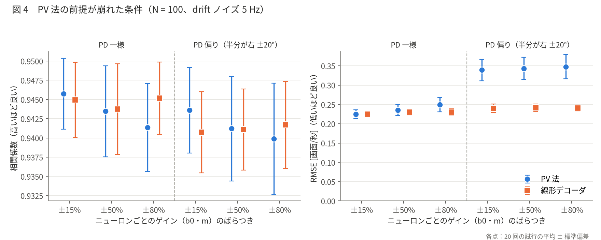
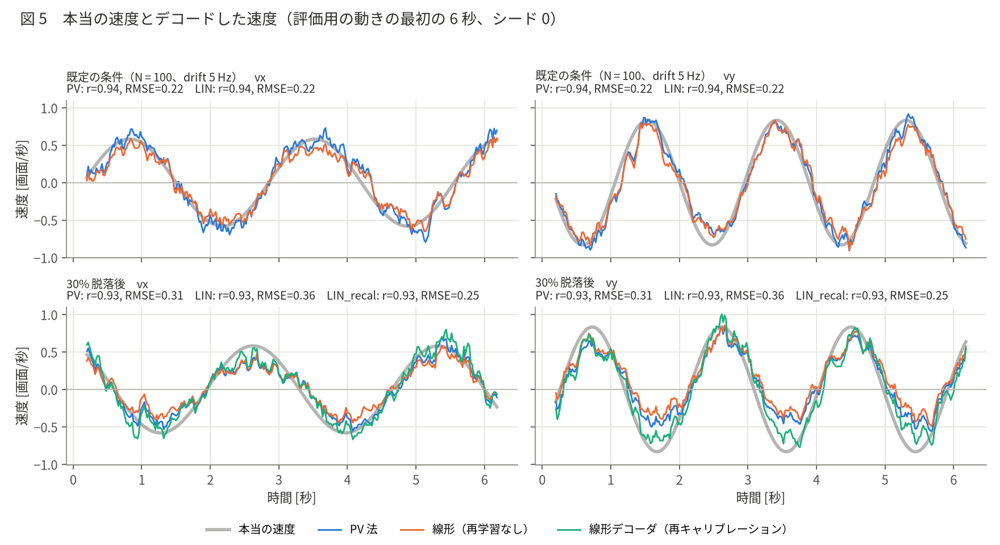

# Pseudo BCI Decoder（擬似 BCI デコーダ体験）

自分の手の動きを Web カメラで取得し、それに応じて「運動野のニューロン集団」がどう発火するかをシミュレーションして 3D で表示します。
さらに、その発火パターン **だけ** から手の動きを推定（デコード）して、カーソルとロボットアームを動かします。
実際の BCI（Brain-Computer Interface）の「脳信号 → デコーダ → 機械を動かす」という流れを、電極なしで体験し、
デコーダの性質（ニューロン数・ノイズ・脱落への強さ）を実験で確かめられる作品です。

OpenCV（カメラ取得・手の特徴点の描画・文字の描画）と OpenGL（シェーダーによる 3D 描画）を両方使っています。



## 目次

1. [作品の目的と、実際の BCI との対応](#1-作品の目的と実際の-bci-との対応)
2. [実行方法](#2-実行方法)
3. [画面の見方とキー操作](#3-画面の見方とキー操作)
4. [仕組み](#4-仕組み)（手の動き → 発火、ノイズ、PV 法と線形デコーダ、カーソル、ロボットアーム、評価指標）
5. [実験モード](#5-実験モード)（使い方、結果、考察）
6. [このシミュレーションで再現できていること / できていないこと](#6-このシミュレーションで再現できていること--できていないこと)
7. [ファイル構成・ログ](#7-ファイル構成ログ)
8. [参考文献](#8-参考文献)

---

## 1. 作品の目的と、実際の BCI との対応

運動野（M1）に電極を埋め込んだ BCI では、腕を動かそうとしたときのニューロンの発火を記録し、そこから「動かしたい方向・速さ」を推定して、
カーソルやロボットアームを動かします（BrainGate などのヒトの臨床研究、サルのロボットアームによる給餌の実験など）。
この作品では、本物の脳信号の代わりに、**自分の手の速度から運動野のニューロンの発火を数式モデルで作り**、それを BCI と同じ方法でデコードします。

| 実際の BCI | この作品 |
|---|---|
| 腕を動かそうとする（運動の意図） | Web カメラの前で手を動かす（MediaPipe Hands で速度を測る） |
| M1 のニューロンが発火する | コサインチューニング + ポアソン過程でスパイクを生成（`neuron_model.py`） |
| 多電極アレイでスパイクを記録し、20〜100 ms ごとに数える | 20 ms のビンでスパイク数を数え、100 ms の窓で発火率を推定 |
| 記録の雑音、ニューロンの脱落（電極の劣化） | 2 種類のノイズ（N/M、1/2/3 キー）、脱落（K キー） |
| デコーダ（PV 法、線形回帰、カルマンフィルタなど） | PV 法と、リッジ回帰による線形デコーダ（`decoder.py`） |
| 使う前にキャリブレーション（ターゲットを追う課題） | L キーのキャリブレーション（8 方向の往復 + 円運動、約 26 秒） |
| カーソル・ロボットアームを動かす | 推定速度を積分したカーソルと、逆運動学で動く 2 関節アーム |

この作品で確かめられること：
- ニューロンの数が多いほど、独立なノイズが平均化されて精度が上がる（集団符号化）
- PV 法は「好きな方向が一様に分布している」などの前提に頼っており、前提が崩れるとかたよる
- 線形デコーダはキャリブレーションのデータから学習するので、前提が崩れても、脱落が起きても、学習し直せば精度が戻る

## 2. 実行方法

仮想環境は一番上の階層の `.venv` を共用します（作り方は一番上の README.md を参照）。

```bash
cd 02_pseudo_bci
../.venv/bin/python main.py                  # カメラで手を追跡
../.venv/bin/python main.py --test           # マウスを手の代わりにする（テストモード）
../.venv/bin/python main.py --camera 1       # 0 番以外のカメラを使う
../.venv/bin/python main.py --experiment     # 画面なしの自動実験モード（約 30 秒。5 章）
```

カメラが見つからない場合は、自動的にテストモードで起動します。

## 3. 画面の見方とキー操作

| 場所 | 内容 |
|---|---|
| 左上 | 運動野のニューロン（3D）。色 = 好きな方向（右の「PD color」の円と対応）、明るさ = 発火率の高さ、一瞬の光 = スパイク、灰色 = 脱落 |
| 右上 | 白いリング = 本当の手の位置、黄色 = PV 法のカーソル、水色 = 線形デコーダのカーソル、細い線 = 手とのズレ。ロボットアーム（3D）は、使っているデコーダのカーソルを手先の目標にして逆運動学で動く。薄い半円 = アームの届く範囲。左の「velocity」の円は速度の比較（白 = 本当、色 = 推定） |
| 下 | スパイクのラスタープロット（横軸：直近 4 秒、縦軸：ニューロン番号。番号は好きな方向の順に並べてあるので、手の向きを変えると光る帯が上下に移る） |
| HUD | モード、手の検出状態、ニューロン数、ノイズの種類と強さ、使っているデコーダ、線形デコーダの状態、相関係数、RMSE（比較モードでは 2 つを並べる） |

### キー操作（3D ウィンドウで）

| キー | 動作 |
|---|---|
| ↑ / ↓ | ニューロン数を増やす / 減らす（20 ずつ、10〜400。作り直すので線形デコーダの学習結果は消える） |
| N / M | ノイズを強く / 弱くする（5 Hz ずつ、0〜100 Hz） |
| 1 / 2 / 3 | ノイズの種類：1 = drift（ゆっくりしたゆらぎ）、2 = independent（独立なゆらぎ）、3 = both（両方） |
| K | 生きているニューロンの 1 割をランダムに脱落させる |
| L | キャリブレーション開始（約 26 秒）。もう一度押すと中止 |
| C | 使うデコーダ（カーソルとアームを動かすもの）の切り替え：PV 法 ⇔ 線形デコーダ（学習後のみ） |
| V | 比較モード：PV 法と線形デコーダのカーソルを 2 色で同時に表示し、相関・RMSE を並べる |
| A | ロボットアームの表示切り替え（アームあり / カーソルのみ） |
| T | テストモード（マウス）とカメラモードの切り替え |
| D | デバッグ用カメラウィンドウ（手の特徴点と速度の矢印）の表示切り替え |
| R | リセット（ニューロンを作り直し、脱落も元に戻す。線形デコーダの学習結果も消える） |
| ESC | 終了して `logs/bci_日付_時刻.csv` に保存 |

テストモードでは、右の 2D 平面の上でマウスを動かすと、それが「手」になります。

### キャリブレーションの流れ

1. L を押すと、右の平面にマゼンタのターゲットが現れる。最初の 2 秒は中心で止まっているので、手（白いリング）を重ねる
2. ターゲットが 8 方向への往復（12 秒）→ 円運動（左回り・右回り 12 秒）と動くので、手で追いかける
3. 終わると線形デコーダが学習され、自動的に「線形デコーダを使う + 比較モード」になる
4. K で脱落させると HUD に「stale」と出る。もう一度 L を押して学習し直すと、線形デコーダの精度（特に RMSE）が戻る。PV 法は戻らない

## 4. 仕組み

座標は画面（右の平面）の幅を 1 とし、x は右向き、y は上向きです。速度の単位は **画面/秒** です。
シミュレーションは描画とは関係なく、実時間に合わせて Δt = 20 ms 刻みで進めます。

### 4.1 手の追跡（`hand_tracker.py`）

- MediaPipe Hands で 21 個の特徴点を検出し、人差し指の付け根（5 番）を「手の位置」とする（映像は鏡像にして、自分から見た向きと画面の向きをそろえる）
- 速度 = 前のフレームとの位置の差 ÷ 時間 を、直近 0.15 秒で移動平均してなめらかにする
- 手が 0.3 秒以上見えないときは「未検出」として速度 0 にする
- カメラ処理は別スレッドで動かし、描画とシミュレーションの速さに影響しないようにしている

### 4.2 手の動き → ニューロンの発火（`neuron_model.py`）

**コサインチューニング**（Georgopoulos ら 1982）：サルに腕を 8 方向へ動かさせて M1 のニューロンを記録すると、
各ニューロンには「最もよく発火する運動方向（好きな方向、preferred direction: PD）」があり、
発火率は運動方向と PD のなす角のコサインに沿って変わります。速く動くほど変化が大きくなる「速度チューニング」（Moran & Schwartz 1999）も入れて、

$$
\lambda_i(t) = \max\Big(0,\ b_{0,i} + m_i\,|\mathbf v(t)|\cos\big(\theta_{\mathbf v}(t) - \theta_{\mathrm{pd},i}\big) + (\text{ノイズ})\Big)
$$

（$|\mathbf v|\cos(\theta_{\mathbf v} - \theta_{\mathrm{pd},i}) = \mathbf v\cdot\mathbf{pd}_i$ なので、内積で計算しています）

| 記号 | 意味 | 値 |
|---|---|---|
| $b_{0,i}$ | ベースライン発火率（動いていないとき） | 25 Hz × (1 ± 15%) |
| $m_i$ | 変調の深さ（速さ 1 画面/秒あたりの変化） | 25 Hz × (1 ± 15%) |
| $\mathbf{pd}_i$ | 好きな方向の単位ベクトル | 円周上に一様にランダム |

ばらつき（±15%）はニューロンごとに固定で、デコーダはこれを知りません。

**ポアソン過程によるスパイク**：実際のニューロンは発火率どおりに規則正しく発火するのではなく、確率的に発火します。各 20 ms のビンのスパイク数を

$$
n_i(t) \sim \mathrm{Poisson}\big(\lambda_i(t)\,\Delta t\big)
$$

で生成します。これは、記録したスパイク列を「ビンごとのスパイク数」として扱う実際の BCI の前処理（spike binning）に対応します。
動いていないときでも 1 ビンに平均 0.5 個のスパイクがランダムに出るので、ポアソン過程そのものも大きな雑音源です。

### 4.3 ノイズのモデル（1/2/3 キー、N/M キー）

| 種類 | 加えるもの | 意味 | デコードへの影響 |
|---|---|---|---|
| ① drift | $\sigma\,\xi_i(t)$。$\xi_i$ はオルンシュタイン＝ウーレンベック過程（時定数 τ = 0.5 秒、標準偏差 1） | 覚醒度・注意・他の脳活動によるベースラインのゆっくりした変動 | 数百 ms〜数秒同じ向きにずれるので、推定速度にゆっくりしたかたよりが乗り、カーソルが流される |
| ② independent | $\sigma\,\eta_i(t)$。$\eta_i(t) \sim \mathcal N(0,1)$ をビンごと・ニューロンごとに独立に引く | シナプス入力の細かい変動など、ニューロンどうし・時刻どうしで相関のない成分 | デコーダが N 個を足し合わせると打ち消し合い、誤差はおよそ $1/\sqrt N$ で小さくなる |
| ③ both | ①と②の両方（同じ σ） | | |

$$
\xi_i(t+\Delta t) = \xi_i(t) - \xi_i(t)\frac{\Delta t}{\tau} + \sqrt{\frac{2\Delta t}{\tau}}\ \mathcal N(0,1)
$$

どちらのノイズも発火率に加えたあとで 0 未満を 0 に切り、そこからポアソン分布でスパイクを作ります（スパイクはいつも整数）。
σ が大きいと 0 で切られる時間が増え、変調が小さく見えるというかたよりも生じます。

**脱落（K キー）**：慢性埋め込み電極では、時間がたつと組織の反応や電極の劣化で記録できるニューロンが減っていきます。脱落したニューロンはスパイク数がずっと 0 になります。

### 4.4 発火率の推定（両方のデコーダで共通）

直近 100 ms（5 ビン）のスパイク数を数えて時間で割ります。

$$
\hat r_i(t) = \frac{1}{0.1\ \mathrm{s}}\sum_{k=0}^{4} n_i(t-k\Delta t)
$$

窓を長くするとなめらかになりますが、そのぶん推定が遅れます（図 5 で、推定が本当の速度より少し遅れて見えるのはこのため）。

### 4.5 ポピュレーションベクトル法（PV 法、Georgopoulos ら 1986）

各ニューロンが「自分の好きな方向」に、発火の強さに応じた票を入れ、全員の票を足し合わせた向きを運動方向とします。

$$
\hat{\mathbf v}(t) = \frac{2}{N}\sum_{i=1}^{N} \frac{\hat r_i(t) - \bar b_0}{\bar m}\ \mathbf{pd}_i
$$

- $(\hat r_i - \bar b_0)/\bar m$ は、コサインチューニングの式を逆に解いた $|\mathbf v|\cos(\theta_{\mathbf v}-\theta_{\mathrm{pd},i})$ の推定値
- PD が円周上に一様なら、全員の票の和は「$\mathbf v$ の向きの単位ベクトル × N/2」に近くなるので、$2/N$ を掛けると大きさも含めた速度の推定値になる
- $\bar b_0, \bar m$ は集団の平均値（25 Hz）。個々のばらつきや、どのニューロンが脱落したかはデコーダには分からない

**前提**：各ニューロンの PD が事前に分かっていること、PD が一様に分布していること、全員がほぼ同じ $b_0, m$ を持つこと。
実験では、サルに 8 方向へ腕を動かさせて PD を測ってから使います（Velliste ら 2008 のロボットアームによる給餌など）。

### 4.6 線形デコーダ（最小二乗法・リッジ回帰）

発火率のベクトル $\hat{\mathbf r}(t)$ から、速度を 1 次式で予測します（$W$：N × 2 の重み行列、$\mathbf c$：切片）。

$$
\hat{\mathbf v}(t) = W^{\top}\hat{\mathbf r}(t) + \mathbf c
$$

$W, \mathbf c$ は、キャリブレーションで記録した T 個のサンプル（発火率 $X$：T × N、本当の速度 $Y$：T × 2）から、
二乗誤差に正則化項を加えたものが最小になるように求めます（リッジ回帰）。平均を引いた $X_c, Y_c$ を使うと、解は一度に求まります。

$$
\min_{W,\mathbf c}\ \sum_t \big\|\mathbf y_t - W^{\top}\mathbf x_t - \mathbf c\big\|^2 + \alpha'\|W\|^2
$$

$$
W = (X_c^{\top}X_c + \alpha' I)^{-1}X_c^{\top}Y_c,\qquad \mathbf c = \bar{\mathbf y} - W^{\top}\bar{\mathbf x}
$$

正則化の強さは $\alpha' = 0.5 \times$（$X_c^{\top}X_c$ の対角成分の平均）です（0.01〜2 を試して決めました）。
正則化は、サンプル数に比べてニューロンが多いときや、発火が変化しないニューロン（脱落して 0 のままのもの）があるときに、重みが極端になるのを防ぎます。
脱落したニューロンは $X$ の列がすべて 0 になるので、再キャリブレーションするとその重みは 0 になり、残ったニューロンだけで推定するように学習し直されます。

### 4.7 PV 法と線形デコーダの違い

| | PV 法 | 線形デコーダ |
|---|---|---|
| 事前に必要なもの | 各ニューロンの PD と、集団の平均的な $b_0, m$（モデルの知識） | キャリブレーションのデータ（20〜30 秒） |
| 重み | 決め打ち（$\mathbf{pd}_i$ そのもの） | データから学習（ニューロンごとに違う。切片もある） |
| ニューロンごとのばらつき・PD のかたより | 知らない → かたよりの原因 | 学習で吸収できる |
| 脱落 | 知らない → かたよりが残る | 再キャリブレーションで補正できる |
| 弱点 | 前提が崩れると直せない | 学習データが少ない・ノイズが時間的に相関していると過学習する。学習時と動きが違うと外れる |
| 実際の研究 | Georgopoulos ら 1986、Taylor ら 2002、Velliste ら 2008 | Wessberg ら 2000、Serruya ら 2002、Hochberg ら 2006。カルマンフィルタ（Wu ら 2006、Gilja ら 2012）も観測モデルを最小二乗法で学習する線形デコーダの一種 |

実際の BCI（BrainGate など）では、PD を個別に測る代わりに「キャリブレーション → 回帰で重みを学習」という方法が基本です。
手が動かせない患者では本当の手の速度が測れないので、「ターゲットの方向へ動かそうとしている」と仮定した速度を $Y$ に使います（この作品では本当の手の速度を使っています）。

### 4.8 カーソルとロボットアーム

**カーソル**：推定速度を積分します。速度の誤差は積分すると少しずつたまって端に張り付いてしまう（ドリフト）ので、弱く中心へ引き戻します（リーク積分、λ = 0.4 /秒）。

$$
\mathbf p(t+\Delta t) = \mathbf p(t) + \hat{\mathbf v}(t)\,\Delta t - \lambda\big(\mathbf p(t) - \mathbf p_{\mathrm{center}}\big)\,\Delta t
$$

**2 関節ロボットアーム**（`robot_arm.py`）：肩を平面の下辺の中央に置き、上腕 $L_1 = 0.55$、前腕 $L_2 = 0.45$ とします。
カーソルを手先の目標 $(d_x, d_y)$（肩から見た位置、距離 $r$）として、余弦定理から関節の角度を求めます（逆運動学）。

$$
\cos\theta_2 = \frac{r^2 - L_1^2 - L_2^2}{2L_1L_2},\qquad
\theta_1 = \mathrm{atan2}(d_y, d_x) - \mathrm{atan2}\big(L_2\sin\theta_2,\ L_1 + L_2\cos\theta_2\big)
$$

$r > L_1 + L_2$（遠すぎて届かない）ときは $r = L_1 + L_2$ として解くので、伸びきった状態で目標の方向を向きます（画面に「out of reach」と点線）。
$r < |L_1 - L_2|$ のときは折りたたんだ状態で目標の方向を向きます。
描画は、関節を球・リンクを円柱として 3D で描き、右の平面を真上から正射影で見ることで、アームの手先と 2D のカーソルがぴったり重なるようにしています。

### 4.9 評価指標

- **相関係数**：本当の速度と推定速度の、x 成分どうし・y 成分どうしのピアソン相関の平均。BCI 研究でよく使われる。「向きの変化についていけているか」を見る
- **RMSE**：速度ベクトルの誤差の二乗平均平方根 [画面/秒]。「大きさ・かたよりも含めて合っているか」を見る

推定が一定方向にずれていたり、大きさが何倍かになっていたりしても **相関は高いまま** で、RMSE だけが大きくなります（5 章の結果で何度も出てきます）。
画面では直近 5 秒で計算し、手がほとんど止まっている成分は相関の計算から除きます。

## 5. 実験モード

画面なしで、決まった手の動きを入力して条件を自動で変えながら精度を測り、CSV とグラフに保存します（`experiment.py`、`plots.py`）。

```bash
../.venv/bin/python main.py --experiment                       # すべての実験、各条件 20 回（約 30 秒）
../.venv/bin/python main.py --experiment --trials 50           # 試行回数を変える
../.venv/bin/python main.py --experiment --only dropout        # 一部の実験だけ（neurons, noise, dropout, assumptions）
../.venv/bin/python main.py --experiment --seed 100            # 別のシードから
```

### 5.1 実験の進め方

1 回の試行は次のとおりです。

1. 条件どおりのニューロン集団を作る
2. **キャリブレーション**：画面のキャリブレーションと同じターゲットの動き（8 方向の往復 + 円運動、記録 24 秒）を「手の動き」とし、手がターゲットを完全には追えないことを表す小さなずれを加えて入力し、線形デコーダを学習する
3. **脱落**：条件の割合だけ脱落させ、脱落があればもう一度キャリブレーションして「再キャリブレーションした線形デコーダ」も作る（再学習なしの線形デコーダも残す）
4. **評価**：キャリブレーションとは **別の動き**（リサージュ曲線 10 秒 + ランダムな滑らかな動き 10 秒）を入力し、各デコーダの相関と RMSE を測る。学習データと評価データが分かれているので、線形デコーダの「覚えただけ」の精度にはならない

各条件をシードを変えて 20 回（`--trials`）試行し、平均 ± 標準偏差を出します。シード i の手の動きはどの条件でも同じにしているので、条件どうしの差が見やすくなっています。

| 実験 | 変える条件 | ほかの条件 |
|---|---|---|
| neurons | ニューロン数 10, 20, 50, 100, 200, 400 × ノイズ drift / independent（どちらも 30 Hz） | ゲインのばらつき ±15%、PD 一様、脱落なし |
| noise | 独立ノイズ 0, 10, 20, 40, 60, 80, 100 Hz × ニューロン数 20, 100, 400 | 同上 |
| dropout | 脱落率 0, 10, 30, 50% | N = 100、drift 5 Hz |
| assumptions | PD の分布（一様 / 半分のニューロンが右方向 ±20° に集中）× ゲインのばらつき ±15, 50, 80% | N = 100、drift 5 Hz |

結果は `results/実行日時/` に保存されます。

| ファイル | 内容 |
|---|---|
| `trials.csv` | 全試行の結果（条件、シード、デコーダ、相関、RMSE） |
| `summary.csv` | 条件 × デコーダごとの平均と標準偏差 |
| `traces.csv` | 図 5 の時系列（本当の速度と各デコーダの推定速度） |
| `fig1〜fig5_*.png` | グラフ（日本語フォントがなければ英語で描く） |

### 5.2 結果（`results/20261112_151353/`、各条件 20 回）

#### 図 1　ニューロン数とデコード精度



- どちらのノイズでも、ニューロン数が増えるほど相関が上がり、RMSE が下がる。独立ノイズ 30 Hz の PV 法では、N = 10 → 100 → 400 で相関 0.67 → 0.92 → 0.96、RMSE 0.60 → 0.28 → 0.23
- 独立ノイズでは PV 法と線形デコーダがほぼ同じ（前提どおりの条件では、PV 法はすでにほぼ最適）
- **drift ノイズでは線形デコーダの方が悪い**（N = 100 で RMSE 0.40 vs PV 法 0.32）。理由は 5.3 で考察

#### 図 2　独立ノイズの強さと RMSE



- ノイズが強くなるほど RMSE が上がるが、上がり方はニューロン数が多いほどゆるやか（PV 法、σ = 0 → 100 Hz で、N = 20 は 0.36 → 0.89、N = 400 は 0.18 → 0.36）。ニューロンどうしで独立なノイズは、足し合わせると平均化されて打ち消し合うため
- N = 20 で強いノイズのとき、線形デコーダの RMSE が PV 法より小さい（σ = 100 Hz で 0.63 vs 0.89）。ただし相関は線形デコーダの方が低い（0.43 vs 0.48）。リッジ回帰は「確信が持てないときは小さめに推定する」ように学習するので、推定のぶれ（分散）が減って RMSE は下がるが、向きの追従は良くならない（かたよりと分散のトレードオフ）

#### 図 3　ニューロンの脱落と精度



- **相関はほとんど下がらない**（脱落 50% でも 0.95 → 0.92）が、**RMSE は大きく上がる**（PV 法 0.23 → 0.41、線形・再学習なし 0.23 → 0.44）
- 脱落したニューロンは「発火率 0」と読まれ、デコーダはそれを「その PD と逆向きに動いている」と解釈するので、一定方向のかたよりが乗る。かたよりは相関では見えないが RMSE には出る（図 5 下段：推定が全体に一方へずれている）
- **再キャリブレーションした線形デコーダはほぼ回復する**（脱落 50% でも RMSE 0.26）。脱落したニューロンの重みが 0 になり、残ったニューロンだけで学習し直されるため。実際の BCI でも、デコーダを定期的に（毎日）再キャリブレーションするのはこのため
- 再学習なしの線形デコーダは PV 法より少し悪い。学習した重みは PD より大きさのばらつきが大きく、なくなったニューロンのぶんのかたよりが大きくなりやすいためと考えられる

#### 図 4　PV 法の前提が崩れた条件



- **PD がかたよると PV 法の RMSE が大きく悪化する**（0.23 → 0.34）が、線形デコーダはほぼ変わらない（0.23 → 0.24）。PD が右に集中していると、PV 法の票が右向き成分を大きく見積もり（x と y で倍率が違う）、$2/N$ の正規化も合わなくなる。線形デコーダは、データから向きごとの倍率を学習するので補正できる（Salinas & Abbott 1994 が指摘した PV 法の弱点と、その解決法としての最適線形推定に対応）
- このときも相関はほとんど変わらない（0.94 前後）。誤差の正体が「倍率のずれ」なので、相関では見えない
- **ゲインのばらつきだけでは、PV 法はあまり悪化しない**（±15% → ±80% で RMSE 0.23 → 0.25）。予想より小さい影響で、理由は 5.3 で考察

#### 図 5　本当の速度とデコードした速度の時系列



- 上段（既定の条件）：PV 法も線形デコーダも本当の速度によく追従している。推定はポアソンノイズで細かく揺れ、100 ms の窓のぶん少し遅れる
- 下段（30% 脱落後）：PV 法と再学習なしの線形デコーダは、山と谷の高さが本当の速度と合わず全体に一方へずれている（特に vy の谷が浅い）。再キャリブレーションした線形デコーダ（緑）は本当の速度に近い

### 5.3 予想と違った結果の考察

**① drift ノイズのとき、線形デコーダの方が PV 法より悪い（図 1 上段）**

線形デコーダは前提によらない分、「前提どおりの条件なら PV 法と同じくらい」になると予想していました。そうならなかった理由を、キャリブレーションの長さを変えて確かめました（N = 100、drift 30 Hz、10 回の平均）。

| キャリブレーションの長さ | 線形デコーダの RMSE（評価データ） | 学習データでの R² | PV 法の RMSE |
|---|---|---|---|
| 24 秒（実験と同じ） | 0.40 | 0.87 | 0.32 |
| 96 秒 | 0.37 | 0.77 | 0.33 |
| 384 秒 | 0.35 | 0.73 | 0.33 |

- キャリブレーションを長くすると評価データでの誤差が下がり、学習データでの R² は下がる → 24 秒では **過学習** している
- drift ノイズは時定数 0.5 秒でゆっくり変わるので、24 秒（1200 サンプル）の中に「独立な」ノイズの値は数十個分しかない。回帰は、たまたまその間に速度と一緒に変化したノイズまで説明に使ってしまう。独立ノイズ（毎ビン新しい値）ではこの問題が起きにくいので、図 1 下段では差がない
- 384 秒でも差が少し残るのは、評価用の動きがキャリブレーションの動きより速く、リッジ回帰の「小さめに推定する」性質が強く出るためと考えられる（学習時と使用時で動きが違うと、学習したデコーダは外れやすい。これは確かめていない）
- 実際の BCI でも、ニューロンの発火はゆっくり変化（非定常）するので、キャリブレーションを長くする・こまめに再キャリブレーションする・使いながら学習し直す（ReFIT など）といった工夫が必要になる

**② ゲインのばらつき（±80%）だけでは PV 法がほとんど悪化しない（図 4 左半分）**

ばらつきはニューロンごとに **独立でランダム** なので、独立ノイズと同じく足し合わせると平均化されます。
$b_0$ のずれは「一定の票」になりますが、PD が一様なら向きがばらばらなので打ち消し合い、残るかたよりは $1/\sqrt N$ 程度です。
$m$ のずれも、全体の倍率としては平均すると 1 に近くなります。
PV 法を崩すのは、ばらつきが **系統的** なとき（PD のかたより、特定の方向のニューロンだけが脱落する、など）です。図 4 の右半分と図 3 がその例です。

**③ 脱落しても相関はほとんど下がらない（図 3）**

脱落による誤差は主に「一定方向のかたより」で、時間的な変化の形は保たれるからです。
BCI の論文で相関係数だけを見ると、このような精度の低下を見落とすことがあるので、RMSE など大きさも含めた指標と一緒に見ることが大切です。

## 6. このシミュレーションで再現できていること / できていないこと

### 再現できていること

- M1 のニューロンの **方向・速度チューニング**（コサインチューニング）と、**ポアソン的な発火のばらつき**
- **集団符号化**：1 個 1 個はノイズが大きくても、多数のニューロンを足し合わせると運動がよく読み取れること。ニューロン数と精度の関係
- BCI の処理の流れ（spike binning → 発火率 → デコーダ → 積分してカーソル → ロボットアーム）と、**キャリブレーション → 学習 → 使用** の手順
- PV 法と線形デコーダの違い（前提に頼るか、データから学習するか）と、それぞれの弱点
- 電極の劣化による **ニューロンの脱落** と、**再キャリブレーションによる回復**
- 評価指標（相関と RMSE）の違い

### 再現できていないこと（実際の脳との違い）

| 実際の脳・BCI | このシミュレーション |
|---|---|
| **ニューロンどうしの相関**：近くのニューロンは共通の入力を受け、ノイズが相関している。相関したノイズは足し合わせても平均化されにくく、ニューロン数を増やしたときの精度の伸びは $1/\sqrt N$ より鈍い | ノイズはニューロンごとに独立（drift も independent も）。そのため図 1・図 2 の「N を増やすと良くなる」効果は実際より大きく出ている |
| **学習による適応**：使っているうちにユーザーの脳がデコーダに合わせて発火を変える（閉ループでの学習、Ganguly & Carmena 2009 など） | ニューロンのチューニングは固定で、カーソルの見た目に応じて変化しない |
| **位置・力・加速度・把持などの情報**：M1 のニューロンは速度だけでなく、位置・力・筋活動・手の形なども表す（混ざった表現） | 速度（2 次元）だけを表す |
| **時間的な性質**：運動の 100 ms ほど前から発火が変わる（運動の準備・意図）。不応期、バースト発火、日をまたいだチューニングの変化 | 発火は今の速度だけで決まり、遅れも先回りもない。ポアソン過程なので不応期もない |
| **3 次元の運動**、両手、身体の姿勢による PD の変化 | 平面（2 次元）の運動だけ |
| **記録の問題**：電極 1 本で複数のニューロンが混ざる、スパイク検出のしきい値、電気的な雑音、LFP | スパイクは完全に分離して記録できるものとしている |
| **手が動かせない患者**：本当の手の速度が分からないので、ターゲットから「意図した速度」を推定して学習する | 本当の手の速度で学習している（健常者が手を動かしている状況に近い） |
| ロボットアームの **動力学**（質量・慣性・関節の速度の上限） | アームは逆運動学で角度をそのまま決める（運動学だけ） |

## 7. ファイル構成・ログ

| ファイル | 役割 |
|---|---|
| `main.py` | 起動、キー操作、メインループ（20 ms 刻みのシミュレーション）、ログ保存。`--experiment` で実験モード |
| `hand_tracker.py` | カメラ処理スレッド（MediaPipe Hands）、速度の計算、テストモード用のマウス入力 |
| `neuron_model.py` | 運動野ニューロン集団（コサインチューニング、ポアソンスパイク、ノイズ 2 種類、脱落、PD のかたより） |
| `decoder.py` | 発火率の推定、ポピュレーションベクトル法・線形デコーダ（リッジ回帰）、カーソル、相関係数・RMSE |
| `calibration.py` | キャリブレーション課題（ターゲットの動き、データの記録） |
| `robot_arm.py` | 2 関節ロボットアームの逆運動学 |
| `experiment.py` | 自動の実験モード（条件の組み合わせ、試行、CSV） |
| `plots.py` | 実験結果のグラフ（matplotlib） |
| `renderer.py` | 描画（3D ニューロン、手とカーソル、ロボットアーム、ラスタープロット、HUD） |
| `gl_utils.py` | 行列・シェーダー読み込みなどの共通処理（01_focus_brain から流用） |
| `session_logger.py` | 操作ログの CSV への記録 |
| `config.py` | ニューロンモデル・デコーダ・キャリブレーション・アーム・描画の設定 |
| `shaders/` | GLSL シェーダー（ニューロン、皮質の曲面、ロボットアーム、2D 図形、テクスチャ） |
| `results/` | 実験モードの結果（実行日時ごとのフォルダ） |
| `docs/` | README 用の画面の画像 |
| `logs/` | 操作ログ（git には入れない） |

### 操作ログ（CSV）の列

20 ms ごとに 1 行記録します。

- 時刻と状態：`time_sec`（シミュレーション時刻）、`mode`、`hand_detected`
- 使っているデコーダの値：`true_vx/vy`（本当の速度）、`decoded_vx/vy`（推定速度）、`error`（速度ベクトルの誤差の大きさ）、`true_x/y`（手の位置）、`cursor_x/y`（カーソル位置）
- ニューロンとノイズ：`n_neurons`、`n_alive`、`noise_hz`、`total_spikes`
- 設定：`decoder`（PV / LIN）、`noise_type`、`calibrating`（キャリブレーション中なら 1）
- PV 法：`pv_vx/vy`、`pv_cursor_x/y`
- 線形デコーダ：`lin_vx/vy`、`lin_cursor_x/y`（学習前は空欄）

## 8. 参考文献

- Georgopoulos, A. P., Kalaska, J. F., Caminiti, R., & Massey, J. T. (1982). On the relations between the direction of two-dimensional arm movements and cell discharge in primate motor cortex. *J. Neurosci.*, 2(11), 1527–1537.
- Georgopoulos, A. P., Schwartz, A. B., & Kettner, R. E. (1986). Neuronal population coding of movement direction. *Science*, 233(4771), 1416–1419.
- Salinas, E., & Abbott, L. F. (1994). Vector reconstruction from firing rates. *J. Comput. Neurosci.*, 1, 89–107.
- Moran, D. W., & Schwartz, A. B. (1999). Motor cortical representation of speed and direction during reaching. *J. Neurophysiol.*, 82(5), 2676–2692.
- Wessberg, J., et al. (2000). Real-time prediction of hand trajectory by ensembles of cortical neurons in primates. *Nature*, 408, 361–365.
- Serruya, M. D., et al. (2002). Instant neural control of a movement signal. *Nature*, 416, 141–142.
- Taylor, D. M., Tillery, S. I. H., & Schwartz, A. B. (2002). Direct cortical control of 3D neuroprosthetic devices. *Science*, 296, 1829–1832.
- Hochberg, L. R., et al. (2006). Neuronal ensemble control of prosthetic devices by a human with tetraplegia. *Nature*, 442, 164–171.
- Wu, W., et al. (2006). Bayesian population decoding of motor cortical activity using a Kalman filter. *Neural Comput.*, 18(1), 80–118.
- Velliste, M., et al. (2008). Cortical control of a prosthetic arm for self-feeding. *Nature*, 453, 1098–1101.
- Ganguly, K., & Carmena, J. M. (2009). Emergence of a stable cortical map for neuroprosthetic control. *PLoS Biol.*, 7(7), e1000153.
- Gilja, V., et al. (2012). A high-performance neural prosthesis enabled by machine learning. *Nat. Neurosci.*, 15, 1752–1757.
- Hochberg, L. R., et al. (2012). Reach and grasp by people with tetraplegia using a neurally controlled robotic arm. *Nature*, 485, 372–375.
