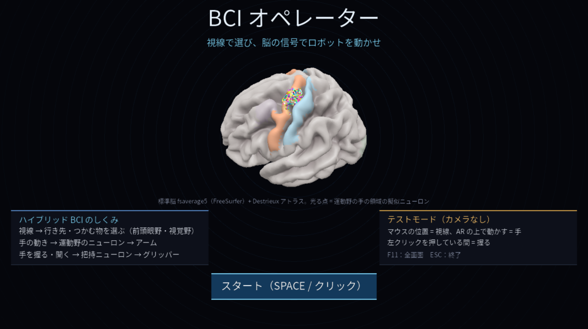
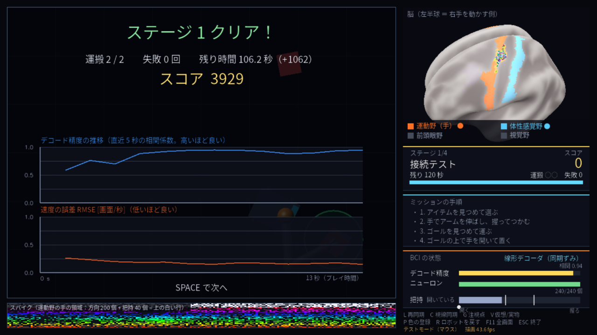

# BCI Operator（BCI オペレーター）

BCI（Brain-Computer Interface）でロボットを操作する「オペレーター」になるゲームです。
実際の BCI 研究の **ハイブリッド BCI**（複数の信号を組み合わせる BCI）をもとに、

- **視線** で行き先やつかむ物を選び（前頭眼野・視覚野）、
- **手の動き** から作った運動野の擬似ニューロンの発火をデコードしてロボットアームを動かし（運動野）、
- **手を握る・開く** から作った把持ニューロンの発火をデコードしてグリッパーでつかむ・放す（運動野・体性感覚野）。

背景はカメラ映像（AR）で、現実の赤・青の物がゲーム内のアイテムになります。横には本物の脳（FreeSurfer の標準脳）の 3D モデルを表示し、今使っている脳の領域が光ります。
OpenCV（カメラ、手・顔の検出の前処理、色の検出、文字）と OpenGL（シェーダーによる 3D 描画）を両方使っています。


## 目次
1. [セットアップと起動](#1-セットアップと起動)
2. [遊び方](#2-遊び方)
3. [操作一覧](#3-操作一覧)
4. [画面の見方](#4-画面の見方)
5. [しくみ](#5-しくみ)
6. [実際の BCI 研究との対応](#6-実際の-bci-研究との対応)
7. [脳の部位](#7-脳の部位)
8. [処理の重さと軽量モード](#8-処理の重さと軽量モード)
9. [再現できていないこと](#9-再現できていないこと)
10. [ファイル構成・ログ](#10-ファイル構成ログ)
11. [参考文献](#11-参考文献)
12. [データのライセンスと出典](#12-データのライセンスと出典)

---

## 1. セットアップと起動

仮想環境は一番上の階層の `.venv` を 01・02 と共用します。03 では nilearn を追加で使います。

```bash
cd opencv-gl-project_NaokiFurusawa
.venv/bin/pip install -r 03_bci_game/requirements.txt

cd 03_bci_game
../.venv/bin/python main.py              # ゲーム（カメラ：視線 + 右手 + 色の物）
../.venv/bin/python main.py --test       # カメラなし：マウスの位置 = 視線、マウスの動き = 手、クリック = 握る
../.venv/bin/python main.py --light      # 軽量モード（重い PC 向け）
../.venv/bin/python main.py --stage 3    # ステージ 3 から始める
../.venv/bin/python main.py --window     # ディスプレイいっぱいにせず 1280×720 のウィンドウで
../.venv/bin/python brain_test.py        # 脳モデルのテスト画面（領域の点灯、pial ⇔ inflated の変形）
```

ゲームはディスプレイいっぱい（最大化したウィンドウ）で開きます。F11 で全画面 ⇔ ウィンドウを切りかえます。
カメラが見つからない場合は、自動的にテストモードで起動します。

### 初回起動（標準脳データの取得）
- **初回はネットワーク接続が必要です。** nilearn が Destrieux アトラス（約 180 KB）を NITRC からダウンロードし、
  fsaverage5（nilearn に同梱）と合わせて `assets/brain_fsaverage5.npz`（約 700 KB）にまとめて保存します。
  2 回目以降はこのファイルだけを読むので、オフラインで動きます（nilearn も読み込みません）。
- **別のパソコンでオフラインで動かすには**、一度ネットワークのある環境で起動してできた `assets/brain_fsaverage5.npz` を、
  相手の `03_bci_game/assets/` にコピーしてください（FreeSurfer のデータを含むので git には入れていません。12 章）。
- **フォールバック（簡易モデル）**：キャッシュがなく、ネットワークにもつながらない（または nilearn が入っていない）ときは、
  左右の半球を楕円体で近似した簡易モデルで起動し、画面に「標準脳データ未取得：簡易モデルで表示中」と表示します。
  領域は MNI 座標でのおおよその位置（中心溝を直線で近似、後頭葉は y < −82 mm など）を式で決め、擬似ニューロンもその上の手の領域に置くので、ゲームはそのまま遊べます。

## 2. 遊び方



1. **タイトル**：SPACE（またはスタートボタンをクリック）
2. **脳と接続中**：右の脳が pial（本物のしわ）から inflated（ふくらませた形）へ変形する
3. **視線同期**：AR 画面の 5 点（四隅 + 中央）が順に光るので、頭を動かさずに見つめる（テストモードでは省略）
4. **ステージの説明** → **同期フェーズ**（約 30 秒）：マゼンタのターゲットを右手でゆっくり追いかけ（白い輪 = 自分の手）、
   最後は「握る！」「開く！」の合図で手を握る・開く。ここで速度と把持のデコーダを学習する

   

5. **ミッション**：アイテムを 2 個ゴールに運ぶ（制限時間 120 秒）。右側の「ミッションの手順」に今どこかが出る
   1. アイテムを約 1 秒見つめる → リングがたまってロックオン → ロボットが近くへ移動
   2. 手を動かしてアームを伸ばす（黄色い小さな輪 = グリッパーの先）→ アイテムの上で手を握ってつかむ
   3. ゴールを約 1 秒見つめる → ロボットが移動
   4. アームをゴールの上へ動かし、手を開いて置く
   - 何もないところで握る（つかみ損ね）・ゴールの外で放す（落とす）と失敗 1 回
   - ロボットが移動している間はアームが動かないので、その間に手をカメラの中央へ戻しておくと楽
6. **ステージクリア**：スコアと、そのステージのデコード精度（相関係数・RMSE）の推移のグラフ → SPACE で次へ

   

7. **結果**：全ステージのスコアと、デコード精度の推移（ステージ別）→ SPACE でタイトルへ

### ステージ

| ステージ | ニューロン（方向 + 把持） | ノイズ | ゴール | 特徴 |
|---|---|---|---|---|
| 1 接続テスト | 200 + 40 | drift 5 Hz | 大 | 操作に慣れる |
| 2 信号が弱い | 60 + 20 | drift 5 Hz | 大 | ニューロンが少なく、デコードが揺れる |
| 3 電極劣化 | 150 + 30 | drift 5 Hz | 大 | プレイ開始 20 秒後に、方向のニューロンの 25%・把持ニューロンの 5% が脱落し、アームが一方へ流されるようになる。**L で再同期**（約 30 秒。制限時間は進む）するか、手で補いながら続けるかを判断する |
| 4 精密作業 | 150 + 30 | drift + independent 25 Hz | 小 | ノイズが強く、小さなゴールに正確に置く |

### スコア
- 置けたとき：1000 + 500 ×（1 − ゴールの中心からの距離 / ゴールの半径）
- 失敗（つかみ損ね・ゴールの外に落とす）：−200
- クリア時：残り時間 1 秒あたり +10

### 現実の色の物
赤・青の物をカメラに映すと、枠がついてアイテムになります（物を動かすと追従する）。反応しないときは、物を AR 画面の中央の点線の枠に入れて **P キー**を押すと、その色を登録できます。
現実の物は動かせないので、つかんだときに「スキャン」して同じ色のデジタルの荷物（立方体）を作り、それを運びます。色の物がないときは V キーで仮想アイテム（立方体）にします。

## 3. 操作一覧

| 入力 | 動作 |
|---|---|
| 視線 | アイテム・ゴールを約 1 秒見つめて選ぶ（荷物を持っていないときはアイテム、持っているときはゴール） |
| 右手を動かす | アームの先を動かす（デコードした速度） |
| 右手を握る / 開く | グリッパーでつかむ / 放す（デコードした把持） |
| SPACE / ENTER | タイトル → 開始、ステージの説明 → 同期フェーズ、クリア → 次のステージ、結果 → タイトル |
| L | 再同期（手の同期フェーズをやり直す。電極劣化のあとに使う。制限時間は進む） |
| C | 視線同期をやり直す |
| G | 注視点（白い点）の表示 / 非表示 |
| V | 現実の色の物 ⇔ 仮想アイテム |
| P | 色の登録（中央の点線の枠に入れた物の色を追加。最大 3 色） |
| R | ロボットを初期位置へ戻す |
| T | タイトル画面で：カメラモード ⇔ テストモード |
| D | デバッグ用のカメラ窓（手・目の特徴点、色の検出結果、処理の fps） |
| F11 | 全画面 ⇔ ウィンドウ |
| ESC | 終了（プレイログを保存） |
| テストモード | マウスの位置 = 視線、AR 画面の上でのマウスの動き = 手、左クリックを押している間 = 握る |

## 4. 画面の見方

| 場所 | 内容 |
|---|---|
| 左（AR） | カメラ映像の上に、ロボット（台座 + 2 関節アーム、3D）、アイテム、ゴール。上の帯 = 今やること、下 = お知らせ |
| 左下 | スパイクのラスタープロット（下 = 方向のニューロン、好きな方向の色。上の白い行 = 把持ニューロン） |
| 右上（脳） | 左半球の外側面。光る領域：運動野（オレンジ）、体性感覚野（水色）、前頭眼野（紫）、視覚野（緑）。手の領域の点 = 擬似ニューロン |
| 右「ステージ」 | ステージ、スコア、残り時間のバー、運搬した数（●）、失敗の回数 |
| 右「ミッションの手順」 | 4 つの手順と、今どこか（▶） |
| 右「BCI の状態」 | 使っているデコーダ（同期前は PV 法、同期後は線形デコーダ）、デコード精度（直近 5 秒の相関）、生きているニューロンの数、把持のメーター（バー = デコードした値、白い縦線 = 「開いた」「握った」のしきい値、白い点 = 本当の手の握り具合） |

## 5. しくみ

```
カメラ（1 台）──┬─ MediaPipe Face Mesh（虹彩）→ 視線の特徴量 → 視線同期の 1 次式 → 平滑化 → 注視点 → ドウェル選択 → 台座が移動
              ├─ MediaPipe Hands ─┬─ 手の速度 → 方向のニューロン（コサインチューニング + ポアソン）→ 線形デコーダ → アームの速度
              │                   └─ 手の開き具合 → 把持ニューロン → 把持のデコーダ → ヒステリシス → グリッパー
              ├─ OpenCV の色の検出（HSV）→ 現実の物 → アイテム
              └─ 左右反転した映像 → AR の背景
```

### 5.1 視線（`vision.py`、`gaze.py`）
- **特徴量**：Face Mesh（虹彩つき）から、目の中の虹彩の位置（目尻〜目頭を基準にした左右・上下）と、顔の向き（両目の中点に対する鼻先のずれ）
- **視線同期**：5 点で、特徴量 → 画面座標の 1 次式を最小二乗法（弱いリッジ回帰）で求める
- **安定化**：直近 0.45 秒の特徴量の平均 → One Euro フィルタ → **固視フィルタ**（注視点が 90 画素以内に留まっている間は止め、外に 0.25 秒以上出たら「視線が跳んだ」とみなして移す）
- **ずれの補正**：選択が決まるたびに「その対象を見ていた」とみなし、ずれの半分を以後の補正に加える（使うほど合ってくる）
- **吸い付き + ドウェル選択**：注視点から 150 画素以内の対象に吸い付き、約 1 秒見つめ続けたら決定。一度吸い付いたら、別の対象がはっきり近くならないかぎり離れない

### 5.2 運動野の擬似ニューロンとデコード（`cortex_sim.py`、`neuron_model.py`、`decoder.py`、`hand_calib.py`）
- **方向のニューロン**（02 と同じ）：発火率 = b0 + m × (手の速度 · 好きな方向) + ノイズ、20 ms ごとにポアソン分布でスパイク
- **把持ニューロン**（03 で追加）：発火率 = b0 + m × g + ノイズ（g = 握り具合。手の指先〜手首の距離 ÷ 手のひらの大きさを 3 次元で測って 0〜1 に）
- **同期フェーズ**：ターゲットを追う区間（8 方向の往復 + 円運動）のデータで、速度の線形デコーダ（リッジ回帰、02 と同じ）を学習。
  「握る！」「開く！」の区間のデータで、把持のデコーダ（把持ニューロンの発火率 → 合図）を学習し、
  「開く」「握る」の合図のときの推定値の間に、その人に合わせたしきい値を置く（ヒステリシス：上のしきい値で「握った」、下のしきい値で「開いた」）
- **アーム**：デコードした速度でアームの先の目標を動かし（02 のカーソルと同じリーク積分）、2 関節の逆運動学で角度を求める（`robot.py`、`robot_arm.py`）

### 5.3 脳の表示（`brain_model.py`、`brain_renderer.py`）
- fsaverage5 の pial と inflated は同じ頂点番号が同じ場所に対応しているので、頂点シェーダーで 2 つの位置を混ぜて変形させる（タイトル = pial、ゲーム中 = inflated）
- 領域は Destrieux アトラスのラベルから決め、頂点ごとの番号をシェーダーに渡して、領域ごとの明るさ（uGlow）で光らせる
- 擬似ニューロンは左半球の手の領域の表面上に、三角形 + 重心座標で置く（変形しても表面に乗ったまま）

## 6. 実際の BCI 研究との対応

| このゲーム | 実際の BCI 研究 |
|---|---|
| 視線で選び、手（運動野）で動かす | **ハイブリッド BCI**：複数の入力（脳信号どうし、または脳信号と視線・筋電など）を組み合わせて、1 つでは難しい操作を実現する（Pfurtscheller ら 2010）。視線で対象を選び、運動の信号で操作する組み合わせも研究されている |
| ドウェル選択（約 1 秒見つめて決定）、吸い付き | 視線入力の基本的な方法。見ただけで選ばれてしまう「ミダス王の接触問題」を避けるため、一定時間の注視を決定とする（Jacob 1990） |
| 手の動き → 方向のニューロン → 線形デコーダ → ロボットアーム | 運動野の多電極記録から腕の速度をデコードし、ロボットアームを動かす（Velliste ら 2008、Hochberg ら 2012、Collinger ら 2013） |
| 手を握る → 把持ニューロン → グリッパーの開閉 | 運動野・運動前野には手の形・つかむ動作で発火するニューロンがあり、BCI でも手の開閉（把持）をデコードする（Carmena ら 2003、Velliste ら 2008、Collinger ら 2013、Wodlinger ら 2015） |
| 同期フェーズ（キャリブレーション） | 使う前に、画面の動きを追う・追うつもりになる課題でデコーダを学習する（open-loop の学習。Hochberg ら 2006、Gilja ら 2012） |
| 電極劣化イベントと再同期 | 慢性埋め込み電極では、記録できるニューロンが時間とともに変わる・減る。デコーダの性能が落ちるので、再キャリブレーションや、使いながら学習し直す方法が研究されている（Perge ら 2013、Jarosiewicz ら 2015） |
| デコード精度（相関・RMSE）の推移 | BCI 研究でデコーダの評価に使う指標（02 の README も参照） |
| 本物の脳（fsaverage5 + Destrieux）、手の領域（hand knob） | 標準脳の上に機能を対応づける脳画像研究の方法。hand knob は中心前回の手の領域の目印（Yousry ら 1997）。BrainGate でも電極はこのあたりに埋め込まれる |

## 7. 脳の部位

| 領域 | Destrieux アトラスのラベル | はたらき | ゲームで光るとき |
|---|---|---|---|
| 運動野（一次運動野 M1） | `G_precentral`（中心前回） | 体の各部の運動を指令する。手の領域は中心前回が後ろへ Ω 字型に張り出した hand knob | 手を動かす・握る |
| 手の領域 | 左半球の `G_precentral` のうち、MNI 座標 (-38, -22, 58) から 16 mm 以内 | 右手の運動は主に左半球の M1 が制御する（運動の神経が延髄で交差するため）。擬似ニューロンをここに置く | 手を動かす・握る |
| 体性感覚野（S1） | `G_postcentral`（中心後回） | 触覚・手の位置の感覚を受け取る | 握る（物に触れる感覚） |
| 前頭眼野（FEF）のあたり | `G_front_middle`（中前頭回）の後ろ側 30% | 目の動き（どこを見るか）を決める。アトラスに専用のラベルがないので近い部分で代用 | 視線で選んでいる間・視線同期 |
| 視覚野 | `Pole_occipital`、`S_calcarine`、`G_cuneus`、`G_oc-temp_med-Lingual` | 目から入った情報を処理する。一次視覚野（V1）は鳥距溝のまわり | 視線で選んでいる間・視線同期 |

## 8. 処理の重さと軽量モード

ソフトウェア描画（GPU なし、Mesa llvmpipe）の PC で計測（カメラモード、同期フェーズ中）：

| 設定 | 描く解像度 | 描画 | カメラ処理 |
|---|---|---|---|
| 通常（`RENDER_SCALE = 1.0`） | 1280×720 | 約 32 fps | 約 31 fps |
| 高解像度（`RENDER_SCALE = 1.5`） | 1920×1080 | 約 25 fps | 約 31 fps |
| 軽量モード（`--light`） | 960×540 | 約 41 fps | 約 31 fps |

- 画面は決まった解像度のオフスクリーンに描いてから、ディスプレイいっぱいへ拡大する（`render_target.py`）。ウィンドウを大きくしても重くならない
- 1 台のカメラで Face Mesh と Hands を両方動かすため、Face Mesh は毎フレーム、Hands は手を追跡中は毎フレーム、見失っている間は手を探す重い処理を間引く（`FACE_EVERY_N`、`HANDS_EVERY_N`、`HANDS_SEARCH_EVERY_N`）
- **軽量モード**（`--light` または `config.py` の `LIGHT_MODE = True`）：描く解像度 0.75 倍、Face Mesh を 2 フレームに 1 回、手の探索を 4 フレームに 1 回、ニューロンの球を粗く、文字の描き直しを 0.15 秒ごと、色の検出の画像を小さく
- アンチエイリアス（`MSAA_SAMPLES`）は既定で切っている（4 にするときれいになるが、カメラ処理と CPU を取り合って描画が約半分になる）

## 9. 再現できていないこと

| 実際の脳・BCI | このゲーム |
|---|---|
| 運動野の信号は、腕を **動かそうとする** だけで出る（手が動かせない人でも使える） | 本物の手の動き・握りから擬似ニューロンの発火を作っている。手を動かさずに操作することはできない |
| ニューロンどうしの相関、位置・力・手の形など多くの情報、運動の前から始まる発火 | 方向（2 次元の速度）と把持（1 次元）だけを表す、独立なノイズのニューロン |
| 使っているうちに脳がデコーダに合わせて変わる（学習による適応） | ニューロンのチューニングは固定 |
| 視線推定には専用のアイカメラ（赤外線）を使い、誤差は 1° 程度 | Web カメラと Face Mesh なので誤差が大きい（100 画素ほど）。吸い付き・ドウェル選択・ずれの補正で補っている |
| 前頭眼野・視覚野・体性感覚野の活動そのものを記録して使う | これらの領域は「今その機能を使っている」ことを示すために光らせているだけで、信号は作っていない |
| 電極の劣化は数週〜数年かけて少しずつ進む | ゲームでは一度に 25% が脱落する |
| ロボットアームの動力学（重さ・慣性）、3 次元の到達運動、物との接触 | 平面上の運動学だけ。つかめるかは距離だけで判定する |

## 10. ファイル構成・ログ

| ファイル | 役割 | 流用元 |
|---|---|---|
| `main.py` | ゲーム本体（画面の流れ、入力、ミッションの進行、ログ） | 新規 |
| `game_view.py` | 描画（タイトル・ゲーム・クリア・結果の各画面、カード、グラフ） | 新規 |
| `render_target.py` | 決まった解像度のオフスクリーンに描いて、ウィンドウいっぱいへ拡大 | 新規 |
| `layout.py` | 画面の配置と座標の変換 | 新規 |
| `vision.py` | カメラ処理スレッド（Hands・Face Mesh・色の検出をまとめて、間引いて処理） | 新規（手の速度は hand_tracker.py を利用） |
| `gaze.py` | 視線同期、平滑化、固視フィルタ、ずれの補正、吸い付き + ドウェル選択 | 新規 |
| `cortex_sim.py` | 運動野の擬似ニューロン（方向 + 把持）、速度・把持のデコーダ、表示用の値とラスター | 02 の main.py / renderer.py の処理をまとめ、把持を追加 |
| `hand_calib.py` | 手の同期フェーズ | 02 の calibration.py をもとに、把持の区間を追加 |
| `mission.py` | ステージの設定、ミッション（つかむ・置く）、把持のヒステリシス、スコア | 新規 |
| `items.py` | 色の物 → アイテムの追跡、仮想アイテム、ゴール | 新規 |
| `robot.py` / `robot_view.py` | 動く台座 + 2 関節アーム、その 3D 描画 | robot_view.py は 02 の renderer.py の ArmView の方法を流用 |
| `brain_model.py` / `brain_renderer.py` | 標準脳の取得・キャッシュ・簡易モデル・領域、脳とニューロンの描画・変形 | 新規 |
| `brain_test.py` | 脳モデルのテスト画面 | 新規 |
| `game_log.py` | プレイログの CSV | 02 の session_logger.py の仕組みを流用 |
| `jtext.py` | 日本語の文字の描画（Pillow + Noto Sans CJK） | 新規 |
| `gfx2d.py` | 2D 図形・テクスチャの描画 | 02 の renderer.py の一部を取り出した |
| `hand_tracker.py`、`neuron_model.py`、`decoder.py`、`gl_utils.py`、`robot_arm.py` | 手の追跡、ニューロンモデル、デコーダ、OpenGL の共通処理、逆運動学 | 02_pseudo_bci からコピー（各ファイルの先頭に記載） |
| `config.py` | すべての設定 | 02 の config.py をもとに追加・変更 |
| `shaders/` | brain（脳の表面）は新規、neuron・arm・flat2d・textured は 02 からコピー | |
| `assets/` | 標準脳データのキャッシュ（git には入れない） | |
| `docs/` | README の画像（テストモードの画面） | |

### プレイログ
`logs/game_日付_時刻.csv` に、描画の 1 フレームごとに 1 行を保存します（ESC で終了したとき）。
列：`time_sec, state, stage, mode, gaze_x/y, dwell_target, dwell_progress, hand_detected, true_vx/vy, decoded_vx/vy, decoder, true_grip, decoded_grip, gripper_closed, holding, robot_x/y, n_alive, n_neurons, score, time_left, event`。
`event` には、画面の切りかわり（state:…）、視線同期の結果（gaze_calib_ok:err_px=…）、同期フェーズの結果（hand_calib_ok:r2=…:grip_sep=…:grip_levels=…）、ロックオン（lock:…）、グリッパー（grip_close / grip_open）、つかむ・置く（grasp_ok / grasp_miss / deliver_ok / drop）、電極劣化（degrade）、再同期（recalibrate_start）などを「;」でつないで記録します。

## 11. 参考文献

- Pfurtscheller, G., et al. (2010). The hybrid BCI. *Frontiers in Neuroscience*, 4, 30.
- Jacob, R. J. K. (1990). What you look at is what you get: eye movement-based interaction techniques. *Proc. CHI '90*, 11–18.
- Casiez, G., Roussel, N., & Vogel, D. (2012). 1 € filter: a simple speed-based low-pass filter for noisy input in interactive systems. *Proc. CHI '12*, 2527–2530.
- Georgopoulos, A. P., Schwartz, A. B., & Kettner, R. E. (1986). Neuronal population coding of movement direction. *Science*, 233, 1416–1419.
- Carmena, J. M., et al. (2003). Learning to control a brain–machine interface for reaching and grasping by primates. *PLoS Biology*, 1(2), e42.
- Hochberg, L. R., et al. (2006). Neuronal ensemble control of prosthetic devices by a human with tetraplegia. *Nature*, 442, 164–171.
- Velliste, M., et al. (2008). Cortical control of a prosthetic arm for self-feeding. *Nature*, 453, 1098–1101.
- Gilja, V., et al. (2012). A high-performance neural prosthesis enabled by machine learning. *Nature Neuroscience*, 15, 1752–1757.
- Hochberg, L. R., et al. (2012). Reach and grasp by people with tetraplegia using a neurally controlled robotic arm. *Nature*, 485, 372–375.
- Collinger, J. L., et al. (2013). High-performance neuroprosthetic control by an individual with tetraplegia. *The Lancet*, 381, 557–564.
- Perge, J. A., et al. (2013). Intra-day signal instabilities affect decoding performance in an intracortical neural interface system. *Journal of Neural Engineering*, 10, 036004.
- Wodlinger, B., et al. (2015). Ten-dimensional anthropomorphic arm control in a human brain−machine interface: difficulties, solutions, and limitations. *Journal of Neural Engineering*, 12, 016011.
- Jarosiewicz, B., et al. (2015). Virtual typing by people with tetraplegia using a self-calibrating intracortical brain-computer interface. *Science Translational Medicine*, 7, 313ra179.
- Yousry, T. A., et al. (1997). Localization of the motor hand area to a knob on the precentral gyrus. A new landmark. *Brain*, 120(1), 141–157.
- Fischl, B., Sereno, M. I., Tootell, R. B. H., & Dale, A. M. (1999). High-resolution intersubject averaging and a coordinate system for the cortical surface. *Human Brain Mapping*, 8(4), 272–284.
- Destrieux, C., Fischl, B., Dale, A., & Halgren, E. (2010). Automatic parcellation of human cortical gyri and sulci using standard anatomical nomenclature. *NeuroImage*, 53(1), 1–15.

## 12. データのライセンスと出典

脳のデータは **このリポジトリには含めず**（`.gitignore` で除外）、初回起動時に nilearn で取得します。

- **fsaverage5**（FreeSurfer の標準脳の皮質表面）
  - FreeSurfer（Laboratory for Computational Neuroimaging, Martinos Center, Massachusetts General Hospital）の配布物の一部で、nilearn に同梱されているものを使用
  - ライセンス：FreeSurfer Software License Agreement（https://surfer.nmr.mgh.harvard.edu/fswiki/FreeSurferSoftwareLicense）
  - 出典：Fischl ら (1999)（上の参考文献）
- **Destrieux アトラス**（aparc.a2009s。皮質の回・溝のラベル）
  - FreeSurfer に含まれるアトラス。nilearn の `fetch_atlas_surf_destrieux` で NITRC（https://www.nitrc.org/）から取得
  - ライセンス：FreeSurfer の配布物として、上と同じ FreeSurfer のライセンスに従う
  - 出典：Destrieux ら (2010)（上の参考文献）
- **nilearn**（データの取得に使用）：BSD ライセンス。https://nilearn.github.io/
- **MediaPipe**（手・顔の検出）：Apache License 2.0
- **Noto Sans CJK**（日本語の文字。システムのフォントを使用）：SIL Open Font License
