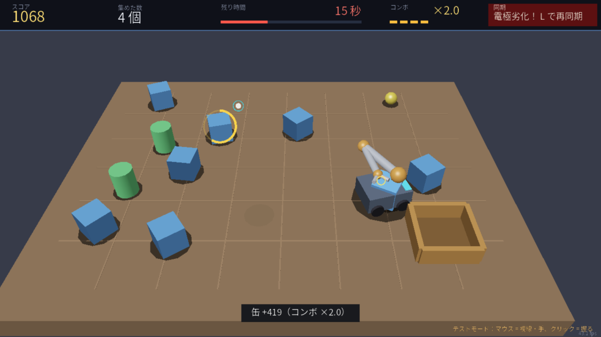
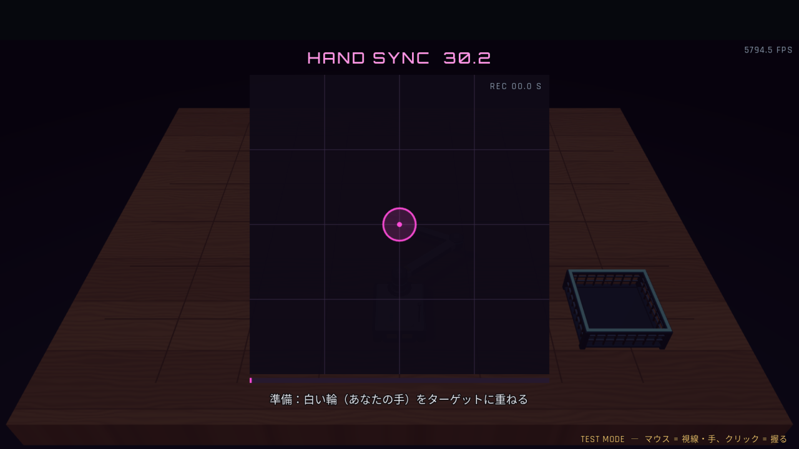
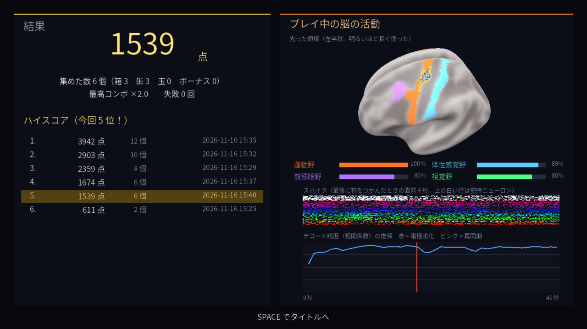

# BCI Operator（BCI オペレーター）

BCI（Brain-Computer Interface）でロボットを操作して、**制限時間内に机の上の物をどれだけ集められるか** を競うゲームです。
実際の BCI 研究の **ハイブリッド BCI**（複数の信号を組み合わせる BCI）をもとに、

- **視線** で集める物・カゴを選び、
- **手の動き** から作った運動野の擬似ニューロンの発火をデコードしてロボットアームを動かし、
- **手を握る・開く** から作った把持ニューロンの発火をデコードしてグリッパーでつかむ・放す。

現実の赤・青の物をカメラに見せると、3D の世界にボーナスアイテムが降ってきます。
プレイ中には「電極劣化」が起き、再同期（キャリブレーションのやり直し）をするかどうかを自分で判断します。
脳の表示は、タイトル（本物の脳が「接続中」でふくらむ演出）、結果画面の「プレイ中の脳の活動」の振り返り、B キーの「裏側」で見られます。
OpenCV（カメラ、色の検出、文字）と OpenGL（シェーダーによる 3D 描画）を両方使っています。



## 目次
1. [セットアップと起動](#1-セットアップと起動)
2. [遊び方とルール](#2-遊び方とルール)
3. [操作一覧](#3-操作一覧)
4. [画面の見方](#4-画面の見方)
   - [結果画面の見方](#結果画面の見方)
5. [しくみ](#5-しくみ)
6. [実際の BCI 研究との対応](#6-実際の-bci-研究との対応)
7. [脳の部位](#7-脳の部位)
8. [処理の重さと軽量モード](#8-処理の重さと軽量モード)
9. [再現できていないこと](#9-再現できていないこと)
10. [ファイル構成・ログ](#10-ファイル構成ログ)
11. [参考文献](#11-参考文献)
12. [データのライセンスと出典](#12-データのライセンスと出典)

---

## 1. セットアップと起動

仮想環境は一番上の階層の `.venv` を 01・02 と共用します。03 では nilearn を追加で使います。

```bash
cd opencv-gl-project_NaokiFurusawa
.venv/bin/pip install -r 03_bci_game/requirements.txt
# GPU で描くための新しい glfw を、03 専用のフォルダに入れる（.venv と 01・02 は変わらない。入れなければソフトウェア描画）
.venv/bin/pip install --no-deps --target 03_bci_game/.libs glfw==2.11.0

cd 03_bci_game
../.venv/bin/python main.py              # ゲーム（カメラ：視線 + 右手 + 色の物）
../.venv/bin/python main.py --test       # カメラなし：マウスの位置 = 視線、マウスの動き = 手、クリック = 握る
../.venv/bin/python main.py --light      # 軽量モード（重い PC 向け）
../.venv/bin/python main.py --window     # ディスプレイいっぱいにせず 1280×720 のウィンドウで
../.venv/bin/python main.py --software   # GPU を使わず、X11 互換モード + ソフトウェア描画で（以前の方式）
../.venv/bin/python main.py --no-degrade # 電極劣化なし（ノーマル）を選んだ状態で始める
../.venv/bin/python main.py --quality high # 画質（light / standard / high。既定は GPU なら standard、ソフトウェア描画なら light）
../.venv/bin/python brain_test.py        # 脳モデルのテスト画面（領域の点灯、pial ⇔ inflated の変形）
```

ゲームはディスプレイいっぱい（最大化したウィンドウ）で開きます。F11 で全画面 ⇔ ウィンドウを切りかえます。
カメラが見つからない場合は、自動的にテストモードで起動します。
起動時に GPU で描けるかを自動で調べ、使えれば GPU、使えなければソフトウェア描画で開きます（8 章「描画方式」）。

### 初回起動（標準脳データの取得）
- **初回はネットワーク接続が必要です。** nilearn が Destrieux アトラス（約 180 KB）を NITRC からダウンロードし、
  fsaverage5（nilearn に同梱）と合わせて `assets/brain_fsaverage5.npz`（約 700 KB）にまとめて保存します。
  2 回目以降はこのファイルだけを読むので、オフラインで動きます（nilearn も読み込みません）。
- **別のパソコンでオフラインで動かすには**、一度ネットワークのある環境で起動してできた `assets/brain_fsaverage5.npz` を、
  相手の `03_bci_game/assets/` にコピーしてください（FreeSurfer のデータを含むので git には入れていません。12 章）。
- **フォールバック（簡易モデル）**：キャッシュがなく、ネットワークにもつながらない（または nilearn が入っていない）ときは、
  左右の半球を楕円体で近似した簡易モデルで起動し、「標準脳データ未取得：簡易モデルで表示中」と表示します。ゲームはそのまま遊べます。

## 2. 遊び方とルール


1. **タイトル**：モード（ノーマル / チャレンジ）を選び、SPACE（またはスタートボタンをクリック）。本物の脳が「接続中」で pial → inflated へふくらむ
   - モードは M・← →キー、またはボタンのクリックで切りかえる。選んでいる方が明るく「▶」つきで表示される
2. **視線同期**：画面の 5 点（四隅 + 中央）が順に光るので、頭を動かさずに見つめる。続けて金色の確認の 3 点を見つめ、ずれが 100 画素以下なら合格。超えたら自動でやり直す（2 回失敗したあとは ENTER で、それまでで一番よかった結果で進める）。テストモードでは省略
3. **同期フェーズ**（約 30 秒）：画面中央の同期パッドで、マゼンタのターゲットを右手でゆっくり追いかけ（白い輪 = 自分の手）、
   最後は「握る！」「開く！」の合図で手を握る・開く。ここで速度と把持のデコーダを学習する（左に遊び方が出る）

   

4. **カウントダウン → プレイ（120 秒）**
   1. 物を約 1 秒見つめる → リングがたまってロックオン → ロボットが近づく
   2. 手を動かしてアームを伸ばす（黄色い小さな輪 = グリッパーの先）→ 物の上で手を握ってつかむ
   3. カゴを約 1 秒見つめる → ロボットが運ぶ
   4. アームをカゴの上へ動かし、手を開いて置く → 得点
   - 一度に運べるのは 1 個。持っていないときは物だけ、持っているときはカゴだけを視線で選べる
   - 行き先を決めたあと、つかむ前に別の物へ乗り換えるには **約 2 秒** 見つめる（決めた直後の 1 秒は選べない）。今の行き先を見ているあいだは隣の物に吸い付かない
   - ロボットが移動している間はアームが動かないので、その間に手をカメラの中央へ戻しておくと楽
5. **結果**：スコア、そのモードのハイスコア（上位 10 件）、プレイ中の脳の活動の振り返り → SPACE でタイトルへ（4 章の「結果画面の見方」）

### ルール

| 項目 | 内容（`config.py` で変更できる） |
|---|---|
| 制限時間 | 120 秒（`GAME_TIME`）。最初の同期フェーズは含まない。プレイ中の再同期・視線同期のやり直しは含む |
| 物 | 最初に 6 個（`FIELD_START_ITEMS`）。1 個集めると 2 秒後に 1 個補充（`REFILL_DELAY`、上限 7 個 `FIELD_MAX_ITEMS`）。物どうしは画面で取り違えないよう離して置く（`ITEM_MIN_GAP`） |
| 得点 | 基本点 × 距離の倍率（つかんだ位置がカゴから遠いほど ×1.0〜×2.0）× コンボの倍率 |
| コンボ | 連続で成功すると ×1.0 → ×1.2 → ×1.5 → ×2.0。失敗（つかみ損ね・カゴの外に落とす）で **1 段階だけ** 下がる |
| 落とした物 | カゴの外で放した物は床に残り、拾い直せる |
| ニューロン | 方向のニューロン 120 個 + 把持ニューロン 24 個、ノイズ drift 5 Hz（`GAME_N_NEURONS`、`GAME_NOISE`） |
| モード | **ノーマル**：電極劣化なし。**チャレンジ**：電極劣化あり（下の行）。タイトル画面で選ぶ（既定は `DEGRADE_ENABLED` = チャレンジ、`--no-degrade` でノーマル）。ハイスコアはモードごとに別 |
| 電極劣化（チャレンジのみ） | プレイ開始 25〜95 秒のランダムな時刻に 1〜2 回（2 回なら 20 秒以上空ける）。方向のニューロンの 20%・把持ニューロンの 5% が脱落し、アームが一方へ流されるようになる。**L で再同期**（約 30 秒、時間は進む）するかは自分で判断する |
| ボーナス | 現実の赤・青（と P キーで登録した色）の物を 0.5 秒カメラに見せると、空から降ってくる。次まで 15 秒以上空ける（`BONUS_COOLDOWN`）、1 ゲームで最大 3 回（`BONUS_MAX`） |

| 物 | 形 | 色（質感） | 基本点 |
|---|---|---|---|
| 箱 | 大きい立方体 | 青（プラスチック） | 100 |
| 缶 | 円柱 | 緑（アルマイト） | 150 |
| 玉 | 小さい球 | 赤（つやつや） | 250 |
| ボーナス | 星形（光る） | 金（金属） | 500 |

### 電極劣化が起きたとき（チャレンジのみ）
画面が赤くフラッシュし、視点が揺れ、HUD の「同期」が赤く点滅して「電極劣化！ L で再同期」と出ます。
劣化のあとはデコーダの推定が一方へかたよるので、アームが流されます。手で補いながら続けるか、時間を使って再同期するかを選びます。

## 3. 操作一覧

| 入力 | 動作 |
|---|---|
| 視線 | 物・カゴを約 1 秒見つめて選ぶ（行き先の乗り換えは約 2 秒） |
| 右手を動かす | アームの先を動かす（デコードした速度） |
| 右手を握る / 開く | グリッパーでつかむ / 放す（デコードした把持） |
| 現実の赤・青の物をカメラに見せる | ボーナスアイテムが降ってくる |
| SPACE / ENTER | タイトル → 開始、結果 → タイトル |
| L | 再同期（手の同期フェーズをやり直す。電極劣化のあとに使う。ノーマルでも使える。時間は進む） |
| M / ← → / クリック | タイトル画面で：モードの切りかえ（M = 入れかえ、← = ノーマル、→ = チャレンジ） |
| C | 視線同期をやり直す（時間は進む） |
| B | 「裏側」：脳（左半球、擬似ニューロンつき）とラスターを半透明で重ねる（既定はオフ） |
| G | 注視点（白い点）の表示 / 非表示 |
| P | 色の登録（カメラ映像の中央に物を入れて押すと、その色の物でもボーナスが降るようになる。最大 3 色） |
| R | ロボットを初期位置へ戻す |
| T | タイトル画面で：カメラモード ⇔ テストモード |
| D | デバッグ用のカメラ窓（手・目の特徴点、色の検出結果、処理の fps） |
| F11 | 全画面 ⇔ ウィンドウ |
| ESC | 終了（プレイログを保存） |
| テストモード | マウスの位置 = 視線、マウスの動き = 手、左クリックを押している間 = 握る |

## 4. 画面の見方

| 場所 | 内容 |
|---|---|
| 中央 | 机の上の 3D の場面（物・カゴ・ロボット・影）。斜め上から見下ろす固定の視点（ロボットを少しだけ追う） |
| 上の HUD | SCORE（スコア）、ITEMS（集めた数）、TIME（残り時間とバー）、COMBO（倍率と 4 段階の目盛り）、NEURAL LINK（チャレンジのみ。同期の状態：LINK STABLE = 同期 良好 / LINK DEGRADED = 電極劣化、L で再同期 / RESYNC = 再同期中）。ノーマルでは代わりに MODE NORMAL |
| 右下 | 小さなカメラ映像（手の骨格つき）。手・顔が見えているか（○ / ×） |
| 3D の上 | 黄色い小さな輪 = グリッパーの先、黄色いリング = 見つめている物（たまると決定）、白い点 = 注視点、「+250」= 得点 |
| B キー | 右上に脳（光る領域と擬似ニューロン）、その下にラスター（下 = 方向のニューロン、上の白い行 = 把持ニューロン） |
| 結果 | 下の「結果画面の見方」を参照 |

### 結果画面の見方



| 場所 | 内容 | 読み取れること |
|---|---|---|
| 左上 | スコア、集めた数（種類別）、最高コンボ、失敗の回数 | 小さい物（玉）や遠い物を多く集めるほど、また失敗せずに続けるほど点が伸びる |
| 左下 | 今回のモードのハイスコア上位 10 件（日時・スコア・集めた数）。今回が入ったら金色で強調 | 何回か遊んで上達を確かめられる（記録は `saves/highscores.json`） |
| 右上：脳 | 左半球の外側面。プレイ中に各領域が光っていた強さの平均で光らせる（いちばん使った領域を 100% とする） | 運動野（オレンジ）= 手を動かした・握った、体性感覚野（水色）= 握った、前頭眼野（紫）・視覚野（緑）= 視線で選んだ。どの「脳の働き」を多く使ったかの振り返り |
| 右中：スパイク | 最後に物をつかんだ瞬間の直前 4 秒のラスタープロット（下 = 方向のニューロン、好きな方向の色。上の白い行 = 把持ニューロン） | 手を動かした向きで色の帯が変わり、握った瞬間に上の白い行の発火が増える様子が見える |
| 右下：グラフ | デコード精度（直近 5 秒の速度の相関係数）の推移。赤い縦線 = 電極劣化（チャレンジのみ）、ピンクの縦線 = 再同期の開始・終了 | 劣化の直後に精度がどう変わったか、再同期で戻ったかが分かる（手をほとんど動かしていない間は相関が計算できず、線が途切れる） |

## 5. しくみ

```
カメラ（1 台）──┬─ MediaPipe Face Mesh（虹彩）→ 視線の特徴量 → 視線同期の 1 次式 → 平滑化 → 注視点
              │                                              → 3D の物の位置を画面へ投影し、一番近い物に吸い付く → ドウェル選択
              ├─ MediaPipe Hands ─┬─ 手の速度 → 方向のニューロン（コサインチューニング + ポアソン）→ 線形デコーダ → アームの速度
              │                   └─ 手の開き具合 → 把持ニューロン → 把持のデコーダ → ヒステリシス → グリッパー
              ├─ OpenCV の色の検出（HSV）→ 現実の物 → ボーナスアイテム
              └─ 縮小した映像 + 手の骨格 → 右下の小さなカメラ映像
```

### 5.1 視線（`vision.py`、`gaze.py`）
- **特徴量**：Face Mesh（虹彩つき）から、目の中の虹彩の位置と、顔の向き（両目の中点に対する鼻先のずれ）
- **視線同期**：5 点で、特徴量 → 画面座標の 1 次式を最小二乗法（弱いリッジ回帰）で求める
- **確認**：学習に使っていない 3 点（`layout.check_points`）を見つめてもらい、予測した位置との平均のずれを測る。100 画素（`GAZE_CHECK_MAX_ERR`）を超えたらやり直す。学習に使った点での誤差は実際より小さく出る（例：学習した点で約 13 画素でも、確認の点では約 23 画素）ので、こちらで判定する
- 視線同期の間は、小さなカメラ映像を右下から画面の下の中央へ移す（右下の点を隠さないため）
- **安定化**：直近 0.5 秒の特徴量の平均 → One Euro フィルタ → 固視フィルタ（130 画素以内に留まっている間は止め、外に 0.35 秒以上出たら移す）
  → 表示・選択に使う点は、固視フィルタの点へ滑らかに近づける（跳ばずに滑る）。
  実測した揺れの大きさで模擬すると、見つめているときの揺れは約 9 画素、1 フレームの動きは最大でも約 1 画素、別の物へ目を移してから点が追いつくまで約 1 秒
- **ずれの補正**：選択が決まるたびに「その物を見ていた」とみなし、ずれの半分を以後の補正に加える
- **3D の物への吸い付き**：物・カゴの 3D の位置を、今の視点の透視投影で画面上に投影し（`scene3d.project`）、注視点から 150 画素以内で一番近い物に吸い付いて、約 1 秒見つめると決定
- **行き先の固定**：今の行き先は候補から外さず、注視点から 40 画素近いものとして扱う（`CURRENT_PULL_PX`）。視線が今の行き先に吸い付いているあいだは何も決定しないので、見つめ続けても隣の物へ乗り換えない。つかむ前に乗り換えるには 2 秒（`SWITCH_DWELL_SEC`）見つめる必要があり、決めた直後の 1 秒（`LOCK_COOLDOWN`）は次の選択を受け付けない。以前は今の行き先を候補から外していたため、行き先を見続けると視線が隣の物へ吸い付き、ロボットの行き先が約 1 秒ごとに変わっていた（実際のプレイの記録：116 秒で 49 回決定、つかむ前の乗り換え 34 回）

### 5.2 運動野の擬似ニューロンとデコード（`cortex_sim.py`、`neuron_model.py`、`decoder.py`、`hand_calib.py`）
- **方向のニューロン**（02 と同じ）：発火率 = b0 + m × (手の速度 · 好きな方向) + ノイズ、20 ms ごとにポアソン分布でスパイク
- **把持ニューロン**：発火率 = b0 + m × g + ノイズ（g = 握り具合。指先〜手首の距離 ÷ 手のひらの大きさを 3 次元で測って 0〜1 に）
- **同期フェーズ**：ターゲットを追う区間のデータで速度の線形デコーダ（リッジ回帰）、「握る！」「開く！」の区間のデータで把持のデコーダを学習し、その人に合わせたしきい値（ヒステリシス）を決める
- **放す判定**：把持の推定値は、手を握ったままでもノイズで一瞬「開いた」のしきい値を下回ることがある。しきい値の下に 0.3 秒（`GRIP_OPEN_HOLD_SEC`）続いたときだけ放す。実際のプレイの記録で試算すると、握ったままなのに放した回数は 128 回 → 約 10 回に減り、代わりに手を開いてから放すまでが約 0.17 秒 → 約 0.5 秒に遅れる
- **アーム**：デコードした速度でアームの先の目標を動かし（02 のカーソルと同じリーク積分）、2 関節の逆運動学で角度を求める（`robot.py`、`robot_arm.py`）。アームは机と平行な高さの平面で動く

### 5.3 3D の場面（`scene3d.py`、`robot_view.py`、`field.py`）
- 机・物・カゴ・ロボットを、立方体・円柱・球の 3 種類のメッシュ（低ポリゴン）を変換行列で使い回して描く
- 影は、物の下の床に置いた半透明の黒い楕円（光源から計算する影はソフトウェア描画では重いため）
- **光と質感**（画質 standard / high、`shaders/scene_hq.frag`）：主な光（左上手前から暖かい白）・補助の光（右から青みがかった弱い光）・輪郭の光（奥から）と、半球の環境光（上 = 空の青み、下 = 机の木の照り返し）。鏡面反射は Blinn-Phong（正規化つき）+ Fresnel。色は線形の空間で計算し、ACES のトーンマップとガンマ補正で表示する
  - 質感（`scene3d.MATERIALS`）：ロボットの台座 = 暗い金属、アーム = 鋼（周りの明るさが映り込む）、関節 = オレンジのアルマイト、車輪 = ゴム。箱 = プラスチック、缶 = アルマイト、玉 = つやつや、ボーナス = 金
  - 机は板張りの木目（画像を使わず、位置からシェーダーの中で計算）。カゴは HUD に合わせた紺色で、上の縁が水色に光る（ゴールの目印）
  - 遠くは背景の紺色（`SCENE_BG`、HUD の色に合わせた）に溶け込む（フォグ）
  - 画質 light は以前のシェーダー（`scene.frag`：1 つの光 + 半球の環境光）のまま
- ワールド座標 (x, y)（机の上の平面）→ 3D (x − W/2, 高さ, H/2 − y)
- 落ちてくる物（補充・ボーナス）は、簡単な重力の計算で上から落とす

### 5.4 脳の表示（`brain_model.py`、`brain_renderer.py`、`brain_record.py`）
- fsaverage5 の pial と inflated は同じ頂点番号が同じ場所に対応しているので、頂点シェーダーで 2 つの位置を混ぜて変形させる（タイトルの「接続中」）
- 領域は Destrieux アトラスのラベルから決め、領域ごとの明るさで光らせる。擬似ニューロンは左半球の手の領域の表面上に置く
- プレイ中は表示しないが、裏で光り方を計算し続け、`brain_record.py` が「各領域の使われ方（光の強さの時間平均）」「最後に物をつかんだときのラスター」「デコード精度の推移」「劣化・再同期の時刻」を記録して、結果画面で振り返る

## 6. 実際の BCI 研究との対応

| このゲーム | 実際の BCI 研究 |
|---|---|
| 視線で選び、手（運動野）で動かす | **ハイブリッド BCI**：複数の入力を組み合わせて、1 つでは難しい操作を実現する（Pfurtscheller ら 2010） |
| ドウェル選択（約 1 秒見つめて決定）、吸い付き | 視線入力の基本的な方法。見ただけで選ばれる「ミダス王の接触問題」を避けるため、一定時間の注視を決定とする（Jacob 1990） |
| 手の動き → 方向のニューロン → 線形デコーダ → ロボットアーム | 運動野の多電極記録から腕の速度をデコードし、ロボットアームを動かす（Velliste ら 2008、Hochberg ら 2012、Collinger ら 2013） |
| 手を握る → 把持ニューロン → グリッパーの開閉 | 運動野・運動前野には手の形・つかむ動作で発火するニューロンがあり、BCI でも手の開閉をデコードする（Carmena ら 2003、Collinger ら 2013、Wodlinger ら 2015） |
| 同期フェーズ（キャリブレーション） | 使う前に、画面の動きを追う・追うつもりになる課題でデコーダを学習する（Hochberg ら 2006、Gilja ら 2012） |
| 電極劣化イベントと再同期 | 慢性埋め込み電極では、記録できるニューロンが時間とともに変わる・減る。再キャリブレーションや、使いながら学習し直す方法が研究されている（Perge ら 2013、Jarosiewicz ら 2015） |
| デコード精度（相関）の推移 | BCI 研究でデコーダの評価に使う指標（02 の README も参照） |
| 本物の脳（fsaverage5 + Destrieux）、手の領域（hand knob） | 標準脳の上に機能を対応づける脳画像研究の方法。hand knob は中心前回の手の領域の目印（Yousry ら 1997） |

## 7. 脳の部位

| 領域 | Destrieux アトラスのラベル | はたらき | 光るとき |
|---|---|---|---|
| 運動野（一次運動野 M1） | `G_precentral`（中心前回） | 体の各部の運動を指令する。手の領域は中心前回の hand knob | 手を動かす・握る |
| 手の領域 | 左半球の `G_precentral` のうち、MNI 座標 (-38, -22, 58) から 16 mm 以内 | 右手の運動は主に左半球の M1 が制御する（運動の神経が延髄で交差するため）。擬似ニューロンをここに置く | 手を動かす・握る |
| 体性感覚野（S1） | `G_postcentral`（中心後回） | 触覚・手の位置の感覚を受け取る | 握る |
| 前頭眼野（FEF）のあたり | `G_front_middle`（中前頭回）の後ろ側 30% | 目の動き（どこを見るか）を決める。アトラスに専用のラベルがないので近い部分で代用 | 視線で選んでいる間・視線同期 |
| 視覚野 | `Pole_occipital`、`S_calcarine`、`G_cuneus`、`G_oc-temp_med-Lingual` | 目から入った情報を処理する。一次視覚野（V1）は鳥距溝のまわり | 視線で選んでいる間・視線同期 |

## 8. 処理の重さと軽量モード

### 描画方式（GPU / ソフトウェア描画）（`gl_backend.py`）
起動時に、別のプロセスで小さなウィンドウを作って GL_RENDERER と GLFW の版を調べ（約 0.3 秒）、描画方式を自動で選びます。

| 方式 | ウィンドウ | OpenGL | glfw | 選ばれる条件 |
|---|---|---|---|---|
| **GPU** | Wayland のネイティブ | EGL | `03_bci_game/.libs/` の pyglfw 2.11.0（GLFW 3.4） | Wayland のセッションで、GLFW 3.4 以上、GL_RENDERER がソフトウェア描画でない |
| ソフトウェア描画 | X11 互換モード（XWayland） | GLX | `.venv` の pyglfw 2.7.0（GLFW 3.3.9） | `--software`、Wayland でない、GPU のテストに失敗、`.libs/` がない |

- 以前は X11 互換モードで開いていたが、XWayland が DRI3 に対応していないため、Intel の GPU があっても CPU で描くソフトウェア描画（llvmpipe）になっていた
- **GLFW 3.4 が必要**：`.venv` の GLFW 3.3.9 の Wayland 版は、GNOME 46 でウィンドウにクリックもキーも届かなかった（タイトル画面から進めない）。GLFW 3.4 では届くことを確認した。01・02 に影響しないよう、`.venv` は変えずに 03 専用のフォルダ（`.libs/`、git には入れない）へ入れ、GPU のときだけ読み込む
- Wayland 版の glfw が落ちていた原因は、窓枠を描く libdecor の GTK プラグインが GNOME の設定のキー（`antialiasing`）を見つけられずに異常終了することだった。GLFW 3.4 の設定で libdecor を使わず、GLFW が自分で描く簡単な枠にしている
- Wayland では、ウィンドウが見えていない（最小化・ほかのワークスペースなど）あいだ、垂直同期つきの画面の切りかえが返ってこず、ゲームが止まる（実際に確認）。GPU のときは垂直同期を使わず、60 fps（`FRAME_CAP_FPS`）に自分で抑える
- 環境変数 `PYGLFW_LIBRARY_VARIANT`（`x11` / `wayland`）を設定すると、自動の判定より優先される

プレイ画面の fps（自動プレイ、20 秒の平均。Intel Arrow Lake-U、Mesa 25.2.8、`RENDER_SCALE = 1.25`）：

| 条件 | ソフトウェア描画（以前） | GPU |
|---|---|---|
| テストモード | 約 21〜22 fps | **約 60 fps**（上限） |
| カメラモード（カメラ・MediaPipe を動かしたまま） | 約 18〜28 fps | **約 58 fps**（上限 60） |
| 上限を外したとき（テスト / カメラ） | 約 22 fps / — | 約 417 fps / 約 198 fps |

### 画質の 3 段階（`config.QUALITY_PRESETS`、`--quality`）

| 段階 | 描く解像度 | MSAA | 3D のシェーダー | 円柱の分割 / 球 | 自動で選ばれる条件 |
|---|---|---|---|---|---|
| **light**（軽量） | 1.25 倍（1600×900） | なし | 以前のもの（`scene.frag`） | 12 / 80 三角形 | ソフトウェア描画のとき |
| **standard**（標準） | 1.5 倍（1920×1080） | 4 | 新しいもの（`scene_hq.frag`） | 24 / 320 三角形 | GPU のとき |
| **high**（高画質） | 2.0 倍（2560×1440） | 8 | 新しいもの | 40 / 1280 三角形 | `--quality high` のときだけ（発表のデモ用） |

`--light` は、画質 light にしたうえで、さらに解像度・カメラ処理を減らす（重い PC 向け。下の「軽量モード」）。

プレイ画面の fps（自動プレイ、20 秒の平均。上限 60 fps。カッコ内は上限を外したとき）：

| 画質 | 描画方式 | テストモード | カメラモード |
|---|---|---|---|
| light | ソフトウェア描画 | 約 34 fps（以前のコード：約 34 fps） | 約 28 fps（以前のコード：約 27 fps） |
| light | GPU | 約 60 fps | 約 58 fps（約 237 fps） |
| standard | GPU | 約 60 fps | 約 58 fps（約 122 fps） |
| high | GPU | 約 60 fps | 約 58 fps（約 79 fps） |

カメラモードで 60 に少し届かないのは、カメラ・MediaPipe の処理と CPU を取り合うため（画質を変える前から同じ）。

以下は、ソフトウェア描画（GPU なし、Mesa llvmpipe）の PC で計測した値（以前の測定）：

| 設定 | 3D を描く解像度 | 描画（カメラモード、プレイ中） | カメラ処理 |
|---|---|---|---|
| `RENDER_SCALE = 1.0` | 1280×720 | 約 33 fps | 約 31 fps |
| **`RENDER_SCALE = 1.25`（既定）** | 1600×900 | **約 31 fps** | 約 29 fps |
| `RENDER_SCALE = 1.5` | 1920×1080 | 約 22 fps | 約 28 fps |
| **軽量モード**（`--light`） | 960×540 | **約 42 fps** | 約 31 fps |

テストモード（カメラなし）の自動プレイでは、描画は約 38〜53 fps でした。

- 3D・図形は決まった解像度のオフスクリーンに描いてから、ディスプレイいっぱいへ拡大する（`render_target.py`）。ウィンドウを大きくしても重くならない
- **文字は、拡大したあとの実際の画面の解像度で描いて最後に重ねる**ので、3D の解像度を下げてもぼやけない。薄い暗い縁取りで、3D の場面の上でも読みやすくしている
- **フォント**（`jtext.py`）：機械的・無機質な見た目にするため、役割ごとに分けている。大きな数字・見出しは **Orbitron**（幅広で角ばった SF 風）、ラベル・計器の表示は字間を空けた **Rajdhani**（細身で角ばった形）、日本語の本文は Noto Sans CJK（細め）。1 つの文字列の中で英数字と日本語を分けて、それぞれのフォントで描いてベースラインをそろえる
- 3D はポリゴン数を少なく（円柱 12 分割、球 80 三角形）、影は楕円を置くだけにしている。プレイ中は脳を描かない（B キーの「裏側」のときだけ描く）
- **軽量モード**（`--light` または `config.py` の `LIGHT_MODE = True`）：3D を描く解像度 0.75 倍、Face Mesh を 2 フレームに 1 回、手の探索を 4 フレームに 1 回、文字の描き直しを 0.15 秒ごと、色の検出の画像を小さく

### 難易度の目安（自動プレイ）
テストモードで、マウスを台本どおりに動かすボットが 120 秒のゲームを 4 回遊んだ結果：集めた数 6〜12 個（平均 約 9 個）、スコア 1674〜3942（平均 約 2720）、失敗 0 回。
物を 6〜7 個に減らし行き先を固定したあとの 2 回：集めた数 8・17 個、スコア 2694・6915。物の数が減っても、ボットは行き先がぶれずに往復できるので、集める数は減っていない（回数が少ないので目安）。
電極劣化が早く起きたゲームほど、集めた数が少なかった。人が手と視線で遊ぶと、これより少なくなる。
難しさは `config.py` の `GAME_TIME`、`GAME_N_NEURONS`、`GAME_NOISE`、`DEGRADE_FRACTION`、`ARM_VEL_GAIN` で調整できる。

## 9. 再現できていないこと

| 実際の脳・BCI | このゲーム |
|---|---|
| 運動野の信号は、腕を **動かそうとする** だけで出る（手が動かせない人でも使える） | 本物の手の動き・握りから擬似ニューロンの発火を作っている |
| ニューロンどうしの相関、位置・力・手の形など多くの情報、運動の前から始まる発火 | 方向（2 次元の速度）と把持（1 次元）だけを表す、独立なノイズのニューロン |
| 使っているうちに脳がデコーダに合わせて変わる（学習による適応） | ニューロンのチューニングは固定 |
| 視線推定には専用のアイカメラ（赤外線）を使い、誤差は 1° 程度 | Web カメラと Face Mesh なので誤差が大きい（100 画素ほど）。吸い付き・ドウェル選択・ずれの補正で補っている |
| 前頭眼野・視覚野・体性感覚野の活動そのものを記録して使う | これらの領域は「今その機能を使っている」ことを示すために光らせているだけで、信号は作っていない |
| 電極の劣化は数週〜数年かけて少しずつ進む | ゲームでは一度に 20% が脱落する |
| ロボットアームの動力学、3 次元の到達運動、物との接触 | 机と平行な平面上の運動学だけ。つかめるかは距離だけで判定する |

## 10. ファイル構成・ログ

| ファイル | 役割 | 流用元 |
|---|---|---|
| `main.py` | ゲーム本体（画面の流れ、入力、ゲームの進行、電極劣化・ボーナスのイベント、ログ） | 新規 |
| `game_view.py` | 描画（タイトル・ゲーム・結果、HUD、同期パッド、裏側、小さなカメラ映像） | 新規 |
| `scene3d.py` | 3D の場面（机・物・カゴ・影、視点、画面への投影） | 新規 |
| `robot_view.py` | メッシュ（立方体・円柱・球）とロボットの 3D 描画 | 02 の renderer.py の ArmView の方法を流用 |
| `field.py` | 机の上の物（種類・配置・補充・ボーナス・落ちてくる動き） | 新規 |
| `mission.py` | ルール（得点・コンボ・電極劣化の予定・ボーナスの制限）、把持のヒステリシス | 新規 |
| `highscore.py` | ハイスコア（モードごとに上位 10 件、日時とスコア）。`saves/highscores.json`（git には入れない。モードを分ける前の記録はチャレンジとして読む） | 新規 |
| `brain_record.py` | 結果画面の振り返り用の記録（領域の使われ方、ラスター、精度の推移、イベント） | 新規 |
| `layout.py` | 画面の配置（同期パッド、視線同期の点） | 新規 |
| `render_target.py` | 決まった解像度のオフスクリーンに描いて、ウィンドウいっぱいへ拡大 | 新規 |
| `gl_backend.py` | 描画方式の自動選択（GPU = Wayland + EGL / ソフトウェア描画 = X11 + GLX）、fps の上限 | 新規 |
| `vision.py` | カメラ処理スレッド（Hands・Face Mesh・色の検出、小さなカメラ映像） | 新規（手の速度は hand_tracker.py を利用） |
| `gaze.py` | 視線同期、平滑化、固視フィルタ、ずれの補正、吸い付き + ドウェル選択 | 新規 |
| `items.py` | 現実の色の物の追跡（ボーナスのきっかけ） | 新規 |
| `cortex_sim.py` | 運動野の擬似ニューロン（方向 + 把持）、速度・把持のデコーダ、ラスター | 02 の main.py / renderer.py の処理をまとめ、把持を追加 |
| `hand_calib.py` | 手の同期フェーズ | 02 の calibration.py をもとに、把持の区間を追加 |
| `robot.py` | 動く台座 + 2 関節アーム | 新規（アームは robot_arm.py） |
| `brain_model.py` / `brain_renderer.py` / `brain_test.py` | 標準脳の取得・キャッシュ・簡易モデル・領域、脳とニューロンの描画・変形、テスト画面 | 新規 |
| `game_log.py` | プレイログの CSV | 02 の session_logger.py の仕組みを流用 |
| `jtext.py` | 文字の描画（Pillow。英数字は Orbitron / Rajdhani、日本語は Noto Sans CJK。字間・縁取り） | 新規 |
| `gfx2d.py` | 2D 図形・テクスチャの描画 | 02 の renderer.py の一部を取り出した |
| `hand_tracker.py`、`neuron_model.py`、`decoder.py`、`gl_utils.py`、`robot_arm.py` | 手の追跡、ニューロンモデル、デコーダ、OpenGL の共通処理、逆運動学 | 02_pseudo_bci からコピー（各ファイルの先頭に記載） |
| `config.py` | すべての設定 | 02 の config.py をもとに追加・変更 |
| `assets/fonts/` | Orbitron・Rajdhani のフォントファイルとライセンス（OFL.txt） | Google Fonts（SIL Open Font License 1.1） |
| `shaders/` | scene・scene_hq（3D の場面。scene_hq は画質 standard / high の光と質感）・brain（脳）は新規、neuron・flat2d・textured は 02 からコピー | |

### プレイログ
`logs/game_日付_時刻.csv` に、描画の 1 フレームごとに 1 行を保存します（ESC で終了したとき）。
列：`time_sec, state, mode, gaze_x/y, dwell_target, dwell_progress, hand_detected, true_vx/vy, decoded_vx/vy, decoder, true_grip, decoded_grip, gripper_closed, holding, holding_type, robot_x/y, n_alive, n_neurons, degrade_count, collected, score, score_delta, combo, time_left, event`。
`event` には、画面の切りかわり（state:…）、モード（mode:normal / mode:challenge）、視線同期・同期フェーズの結果、ロックオン（lock:…）、グリッパー（grip_close / grip_open）、つかむ・置く（grasp_ok:種類 / grasp_miss / deliver_ok:種類:+点数 / drop:種類）、電極劣化（degrade）、再同期（recalibrate_start）、ボーナス（bonus_drop:色）、終了（game_end）などを「;」でつないで記録します。

## 11. 参考文献

- Pfurtscheller, G., et al. (2010). The hybrid BCI. *Frontiers in Neuroscience*, 4, 30.
- Jacob, R. J. K. (1990). What you look at is what you get: eye movement-based interaction techniques. *Proc. CHI '90*, 11–18.
- Casiez, G., Roussel, N., & Vogel, D. (2012). 1 € filter: a simple speed-based low-pass filter for noisy input in interactive systems. *Proc. CHI '12*, 2527–2530.
- Georgopoulos, A. P., Schwartz, A. B., & Kettner, R. E. (1986). Neuronal population coding of movement direction. *Science*, 233, 1416–1419.
- Carmena, J. M., et al. (2003). Learning to control a brain–machine interface for reaching and grasping by primates. *PLoS Biology*, 1(2), e42.
- Hochberg, L. R., et al. (2006). Neuronal ensemble control of prosthetic devices by a human with tetraplegia. *Nature*, 442, 164–171.
- Velliste, M., et al. (2008). Cortical control of a prosthetic arm for self-feeding. *Nature*, 453, 1098–1101.
- Gilja, V., et al. (2012). A high-performance neural prosthesis enabled by machine learning. *Nature Neuroscience*, 15, 1752–1757.
- Hochberg, L. R., et al. (2012). Reach and grasp by people with tetraplegia using a neurally controlled robotic arm. *Nature*, 485, 372–375.
- Collinger, J. L., et al. (2013). High-performance neuroprosthetic control by an individual with tetraplegia. *The Lancet*, 381, 557–564.
- Perge, J. A., et al. (2013). Intra-day signal instabilities affect decoding performance in an intracortical neural interface system. *Journal of Neural Engineering*, 10, 036004.
- Wodlinger, B., et al. (2015). Ten-dimensional anthropomorphic arm control in a human brain−machine interface: difficulties, solutions, and limitations. *Journal of Neural Engineering*, 12, 016011.
- Jarosiewicz, B., et al. (2015). Virtual typing by people with tetraplegia using a self-calibrating intracortical brain-computer interface. *Science Translational Medicine*, 7, 313ra179.
- Yousry, T. A., et al. (1997). Localization of the motor hand area to a knob on the precentral gyrus. A new landmark. *Brain*, 120(1), 141–157.
- Fischl, B., Sereno, M. I., Tootell, R. B. H., & Dale, A. M. (1999). High-resolution intersubject averaging and a coordinate system for the cortical surface. *Human Brain Mapping*, 8(4), 272–284.
- Destrieux, C., Fischl, B., Dale, A., & Halgren, E. (2010). Automatic parcellation of human cortical gyri and sulci using standard anatomical nomenclature. *NeuroImage*, 53(1), 1–15.

## 12. データのライセンスと出典

脳のデータは **このリポジトリには含めず**（`.gitignore` で除外）、初回起動時に nilearn で取得します。

- **fsaverage5**（FreeSurfer の標準脳の皮質表面）
  - FreeSurfer（Laboratory for Computational Neuroimaging, Martinos Center, Massachusetts General Hospital）の配布物の一部で、nilearn に同梱されているものを使用
  - ライセンス：FreeSurfer Software License Agreement（https://surfer.nmr.mgh.harvard.edu/fswiki/FreeSurferSoftwareLicense）
  - 出典：Fischl ら (1999)（上の参考文献）
- **Destrieux アトラス**（aparc.a2009s。皮質の回・溝のラベル）
  - FreeSurfer に含まれるアトラス。nilearn の `fetch_atlas_surf_destrieux` で NITRC（https://www.nitrc.org/）から取得
  - ライセンス：FreeSurfer の配布物として、上と同じ FreeSurfer のライセンスに従う
  - 出典：Destrieux ら (2010)（上の参考文献）
- **nilearn**（データの取得に使用）：BSD ライセンス。https://nilearn.github.io/
- **MediaPipe**（手・顔の検出）：Apache License 2.0
- **Noto Sans CJK**（日本語の文字。システムのフォントを使用）：SIL Open Font License 1.1
- **Orbitron**（数字・見出し。`assets/fonts/Orbitron-Variable.ttf`）：Copyright 2018 The Orbitron Project Authors（https://github.com/theleagueof/orbitron）。SIL Open Font License 1.1（`assets/fonts/Orbitron-OFL.txt`）。Google Fonts から取得
- **Rajdhani**（ラベル。`assets/fonts/Rajdhani-Medium.ttf`、`Rajdhani-SemiBold.ttf`）：Copyright (c) 2014, Indian Type Foundry。SIL Open Font License 1.1（`assets/fonts/Rajdhani-OFL.txt`）。Google Fonts から取得
- フォントファイルがない場合は、Noto Sans CJK で代わりに描く
